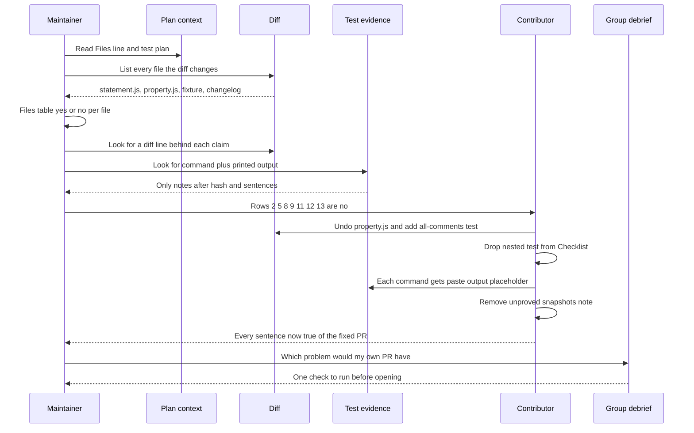
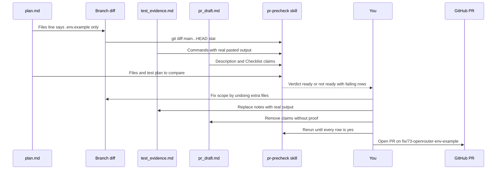

# Unit 4 activity — Read It Like a Maintainer

**Date:** Tue Oct 13, 2026 (America/Denver) · simulated after the live session (group went off on a tangent)
**Scope:** coach / preview note (`beat-1-sandbox/unit-4/` in
[`speculaas/ai301-coursework-trilogy-preview`](https://github.com/speculaas/ai301-coursework-trilogy-preview)).
**User:** Yie Sheng Chen / GitHub `speculaas` · continuity Path Review issue 73, branch
`fix/73-openrouter-env-example` (diff touches `.env.example` only).

## Source table

| Source | Path (zimmnotes `chat/codepath/ai301/`) |
|---|---|
| Worksheet (blank) | `beat-1-sandbox/unit-04/Copy of Unit 4 Activity Worksheet.txt` |
| Staff answers (checks + fix) | `beat-1-sandbox/unit-04/Overview-Activity-Assignment_staff-answer.txt` |
| Our filled answers (corrected to staff) | `beat-1-sandbox/unit-04/2026-10-13-unit4-activity-filled.md`, `...-worksheet-answers.txt` |
| Homework plan | `beat-1-sandbox/unit-04/2026-10-13-unit4-homework-plan.md` |
| calib packages | `beat-1-sandbox/unit-04/ai301-unit4-starter/eval/packages/calib-03.md`, `calib-04.md` |
| Unit 3 style reference | [`../unit-3/2026-09-30-unit3-activity-today.md`](../unit-3/2026-09-30-unit3-activity-today.md) |

## What the activity teaches

1. **Switch sides.** Unit 3 graded the *plan*. Unit 4 grades the *PR* as the maintainer, then fixes it as the contributor.
2. **Plan vs diff = scope.** Every file the diff changes needs a line in the plan's `Files:` that asked for it. A folder or "a changelog entry" counts. An unrelated change loses points even when it's explained.
3. **Proof = a diff line or real printed output.** A sentence ("the suite passes") or a `# note` after a command is not proof. A negative claim ("no options added") is a yes if nothing in the diff adds it.
4. **Fix by subtraction too.** You can make a description true by removing a claim you can't prove, not only by adding work.
5. **Any no means the PR isn't ready to open.**

## Activity flow

## Mapping to the homework pipeline

## Staff answers, row by row (calib-03, prettier#19727)

| # | Item | Staff | Why |
|---|---|---|---|
| 1 | src/language-js/print/statement.js | yes | named in `Files:` |
| 2 | src/language-js/print/property.js | **no** | plan never names it; diff rewrites one of its functions |
| 3 | tests/format/js/if/blank-line-before-else.js | yes | inside the named folder `tests/format/js/if/` |
| 4 | changelog_unreleased/javascript/19727.md | yes | "a changelog entry" names it |
| 5 | "Implements the plan exactly, no changes beyond it" | **no** | property.js changed **and** the all-comments control test is missing |
| 6 | "no options added" | yes | nothing added; `options.quoteProps` is an existing option |
| 7 | test for the issue's input | yes | blank-line-before-else.js is the issue's input |
| 8 | all-comments control test | **no** | no file for it |
| 9 | nested-chains test | **no** | no file for it |
| 10 | changelog added | yes | the diff adds it |
| 11 | before/after output | **no** | `# notes` typed by the author, not output |
| 12 | control unchanged | **no** | only said, not shown |
| 13 | test suite passes | **no** | only said, not shown |

**Staff fix:** undo property.js (row 2, part of 5); add the all-comments control (row 8, rest of 5); row 9 is your call, staff takes it off the Checklist; every Test evidence command gets `[paste output here]`; snapshot note comes out (diff shows no snapshot changes). First paragraph stays, because it's true again.

## Our draft vs staff

- **Phase 1:** all 13 rows matched. We missed the second half of row 5's reason (missing control test) and the `quoteProps` nuance on row 6.
- **Row 9 fix:** we *added* a nested fixture; staff *removes the claim*. The plan didn't ask for it, so matching the plan is enough.
- **Rows 11-13 fix:** we proposed committing snapshots so "snapshots updated" became true; staff deletes the unproved note.
- **Description:** we rewrote paragraph one and added extra `diff ... && echo` commands; staff leaves paragraph one and uses plain command/placeholder pairs.

## Debrief answer (no staff answer given)

> The problem I'm most likely to leave is describing what a command printed instead of pasting it. My #73 change is docs-only (`.env.example`), so it's tempting to write "checks pass". Second is scope creep, like a drive-by README tidy. My check before opening: every `$` command in `test_evidence.md` and `pr_draft.md` is followed by real output (including `make test-integration`'s "no tests ran"), and `git diff main...HEAD --stat` lists only `.env.example`.

## calib-04 (sharkdp/fd#2078, finished early, no staff answer)

- Files: `src/cli.rs` yes, `tests/tests.rs` yes ("tests"), `CHANGELOG.md` no by the strict rule (arguable: repo guide asks for it; fix by adding it to the plan).
- Proved: cap 4096 at parse time (diff lines), clap error with exit 2 (real output), changelog hunk, repro 1 re-run.
- Not proved: repro 2 (`-j 200000 -x echo .`) never re-run; `-j 64` control and `cargo test` (614) are sentences; repro 1 "before" is a `# note`.
- **Does a maintainer still ask for repro 2?** For: the plan named both crashes and it's one command. Against: the cap sits in clap's `value_parser`, so every value over 4096 fails on the same path before any thread starts. Our take: ask, because the plan promised it.

## pr-precheck rubric checks you must write (homework)

Each staff row maps to a rubric check. Write them in `rubric.md`, with where to look in `procedure.md`:

| Rubric check | Activity rows | Pass condition for #73 |
|---|---|---|
| scope: every changed file is in plan `Files:` | 1-4, 2 | `git diff main...HEAD --stat` lists only `.env.example` |
| plan-faithful: nothing beyond the plan, nothing the test plan names missing | 5, 8 | every test-plan item has evidence; no extra files |
| negative claims checked against diff | 6 | e.g. "no code changes" true if diff has no src files |
| checklist lists only what the diff delivers | 9, 10 | drop any item without a diff line |
| evidence = command + real output | 11-13 | no `#` notes or sentences standing in for output |
| no unproved notes (snapshots, "all green") | 13 | remove the claim or show it |
| PR template + AI-use disclosure present | (homework) | required sections filled in `pr_draft.md` |

Verdict rule: **ready only if every required check is yes**, mirroring "any no means the PR isn't ready."
