# AI301 roadmap: where I am (2026-10-14)

> **Update note:** move the `now` class to the current step, and mark finished steps `done`. Add a node when the course adds a step.

Each Beat 1 sandbox tool comes back in Beat 2, upgraded for real repos. The **rubric** is not new homework: it's the `rubric.md` I wrote in Unit 1 (`~/.claude/skills/issue-select/rubric.md`), which carries over into `issue-scout` at install.

```mermaid
flowchart LR
  classDef done fill:#d4f4dd,stroke:#2e7d32,color:#000
  classDef now fill:#fff3b0,stroke:#f9a825,stroke-width:3px,color:#000
  classDef next fill:#e3f2fd,stroke:#1565c0,color:#000

  subgraph B1["Beat 1: Sandbox (Path Review), units 1-4"]
    U1["U1 issue-select<br/>rubric.md + evidence guide<br/>pick + grade an issue"]:::done
    U2["U2 repro-check<br/>reproduce the bug"]:::done
    U3["U3 plan-check<br/>plan + implement on a branch"]:::done
    U4["U4 pr-precheck<br/>test, PR #181 opened, 18/20 eval"]:::done
    U1 --> U2 --> U3 --> U4
  end

  subgraph B2["Beat 2: Real repo contribution, units 5-8 (Assignment 5, 250 pts, due Sun of U8)"]
    U5["U5 issue-scout<br/>search strategy + scan<br/>2-3 Issue Selection picks"]:::now
    U6["U6 Claim Day<br/>claim upstream, voice-guard hook, repo memory"]:::next
    U7["U7 Ship Week<br/>reproduce, plan, build, ship-gate, open real PR"]:::next
    U8["U8 Keeping It Alive<br/>pr-monitor, answer review, finish story"]:::next
    U5 --> U6 --> U7 --> U8
  end

  subgraph B3["Beat 3: Portfolio, units 9-10"]
    U9["U9 portfolio<br/>tool improvements graded"]:::next
    U10["U10 wrap-up"]:::next
    U9 --> U10
  end

  U1 -. "rubric carries over" .-> U5
  U2 -. "same repro discipline" .-> U7
  U3 -. "plan, then implement" .-> U7
  U4 -. "PR read like a maintainer" .-> U7
  U4 --> U5
  U8 --> U9
```

| Sandbox concept (Beat 1) | Real-repo version (Beat 2) |
|---|---|
| Curated issues, all pre-vetted (U1) | Issue Selection site + your own scout search (U5) |
| Claims never blocked anyone | Claim upstream on GitHub; strangers can race you (U6) |
| Repro on Path Review (U2) | Repro in the real repo's setup (U7) |
| Plan comment + branch (U3) | Plan against the real CONTRIBUTING.md and templates (U7) |
| pr-precheck + staff review (U4) | ship-gate before opening, pr-monitor after (U7-U8) |
| Weekly grades | One contribution story, Toolkit entry each unit |

Beat 3 (units 9-10) is the portfolio: the tool improvements I've logged in Toolkit entries since U5 get graded there. Details not yet known; fill them in when the U9 page opens.
