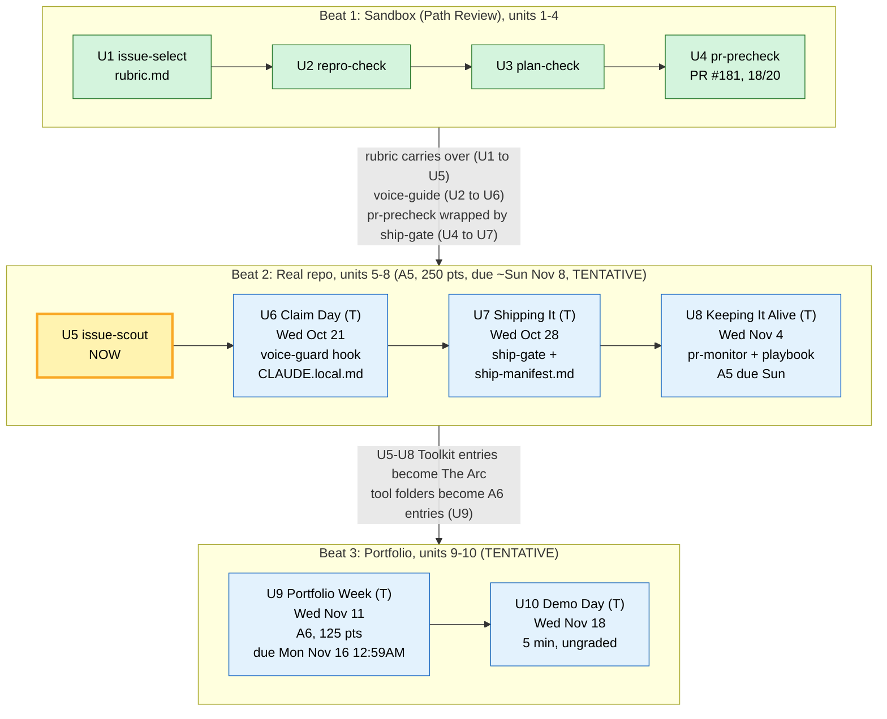
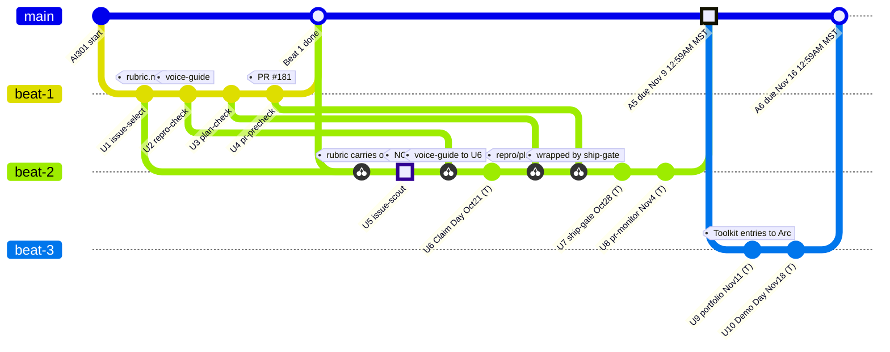

# AI301 roadmap: where I am (2026-10-14)

> **Update note:** move the `now` class to the current step, and mark finished steps `done`. Add a node when the course adds a step.

Each Beat 1 sandbox tool comes back in Beat 2, upgraded for real repos. The **rubric** is not new homework: it's the `rubric.md` I wrote in Unit 1 (`~/.claude/skills/issue-select/rubric.md`), which carries over into `issue-scout` at install.

### Roadmap (wide rows stacked; earlier slender version: commit 46d5ff4)

Arrows that cross between subgraphs make Mermaid ignore `direction LR`, so the cross-beat links are written as labels on the box-to-box arrows.

(T) = TENTATIVE: based on pre-release course pages, as of 2026-10-14; may change.

## Same roadmap as a gitGraph (cross-beat links as cherry-picks)

Experimental alternative to the flowchart above (kept as is). Each beat is a branch. A Beat 1 tool that comes back in Beat 2 is drawn as a **cherry-pick** of that Beat 1 commit, and its tag carries the label the flowchart puts on the arrow. Finishing a beat is a **merge** into `main`.

**Does it fit?** Partly.
- What works: each cross-beat link becomes a cherry-pick from `beat-1` into `beat-2`, so it lands at the exact unit where the tool comes back (rubric at U5, voice-guide at U6, repro/plan and pr-precheck at U7). The flowchart could only lump these into one label between the two boxes.
- Limits:
  - gitGraph has no free arrows or edge labels. Text goes only in commit `id`/`tag`, and every id must be unique.
  - A cherry-pick must take an id from *another* branch, never the current one. It shows as a new commit with a dashed link, not as an arrow to a named target.
  - Beat 2 to Beat 3 ("Toolkit entries become The Arc") is a whole-beat flow, so it can only be a merge plus a tag, not a per-unit link.
  - There are no colors per state (only `NORMAL`/`HIGHLIGHT`/`REVERSE`) and no multi-line boxes.
  - It reads as git history, which it isn't.
- Takeaway: the flowchart is better for the overview, and the gitGraph is better for "which old tool comes back when".

| Sandbox concept (Beat 1) | Real-repo version (Beat 2) |
|---|---|
| Curated issues, all pre-vetted (U1) | Issue Selection site + your own scout search (U5) |
| Claims never blocked anyone | Claim upstream on GitHub; strangers can race you (U6) |
| Repro on Path Review (U2) | Repro in the real repo's setup (U7) |
| Plan comment + branch (U3) | Plan against the real CONTRIBUTING.md and templates (U7) |
| pr-precheck + staff review (U4) | ship-gate before opening, pr-monitor after (U7-U8) |
| Weekly grades | One contribution story, Toolkit entry each unit |
| Rubric scope gate strict (seeded, bounded issues) | TENTATIVE: U6 patch turns scope into a difficulty note; true umbrella issues still fail |
| Classmate claims didn't block | TENTATIVE: a stranger's claim blocks you; never claim over one, release yours honestly (U6) |
| Voice check run by hand via repro-check | TENTATIVE: voice-guard hook on every posting doorway, plus an upstream section in voice-guide.md (U6) |
| Orientation every session | TENTATIVE: one scoped orientation into CLAUDE.local.md (guest repo, never checked in) (U6) |
| pr-precheck on sandbox branch | TENTATIVE: ship-gate on `gh pr create` runs the repo's own checks from ship-manifest.md, then pr-precheck live; PR from your fork (U7) |
| Staff review | TENTATIVE: pr-monitor, headless `claude -p`, read-only gh, drafts moves to files, posts nothing (U8) |
| Beat 1 tools/ upload | TENTATIVE: A6 portfolio in beat-3-portfolio/toolkit-portfolio.md; graders read only that page (U9) |

Beat 3 (TENTATIVE): **U9** is Assignment 6, 125 pts (15 format, 60 featured entries, 30 arc, 20 limitations), written by hand in `beat-3-portfolio/toolkit-portfolio.md`. Feature 3-4 of the six tools in depth (ship-gate + pr-precheck count as one), one inventory line each for the rest, a dated Arc (Date/Friction/Change/Result) from the U5-U8 Toolkit entries, and a Tool limits list. Evidence goes inline; AI may gather excerpts but never drafts prose. Graded at the Sunday snapshot (due Mon Nov 16, 12:59AM MST). **U10** Demo Day (Wed Nov 18): ungraded, 5 minutes plus about 2 minutes of Q&A in rooms of eight, presented straight from the portfolio page with no new slides or live runs.

## Upcoming units at a glance (TENTATIVE: pre-release pages, as of 2026-10-14; may change)

| Unit | Session | What you build | What you submit / write in contribution-story.md | Due |
|---|---|---|---|---|
| U6 Claim Day | Wed Oct 21, 4PM MDT | Fresh scan, pick from Issue Selection site or its top 5, grade (~$0.20), read CONTRIBUTING.md + AI policy, claim same hour; rubric scope patch; voice-guard hook + upstream voice rules; CLAUDE.local.md after class | "Why I Chose This Issue" (saved scan, verdict, claim link, why) + U6 Toolkit entry | nothing (A5 working time) |
| U7 Shipping It | Wed Oct 28, 4PM MDT | ship-gate package, your ship-manifest.md at clone root (repo checks with sources), gate run on real branch; PR from fork when gate passes | Repro/plan chapters, PR link if opened, U7 Toolkit entry | nothing |
| U8 Keeping It Alive | Wed Nov 4, 4PM MST | pr-monitor (`monitor.py --state` free canary), playbook.md (response, staleness, nudge, walk-away) | PR section (Maintainer Feedback, Status), U8 Toolkit entry, Learnings; submit repo link once on the U5 Assignment tab | A5 Sunday ~Nov 8 (exact date on U5 tab) |
| U9 Portfolio Week | Wed Nov 11, 4PM MST | Nothing new; write toolkit-portfolio.md | A6: repo link once | Mon Nov 16, 12:59AM MST |
| U10 Demo Day | Wed Nov 18, 4PM MST | Nothing | 5-min demo from the page | nothing |

What this means now: PR rows are 66 of A5's 250 points and score 0 until a PR exists, so choose an issue a gate can pass by early November. Claim in U6, not before. Only claim when CONTRIBUTING.md allows AI. Keep every scan, verdict and dated change, because they become U9 evidence.
