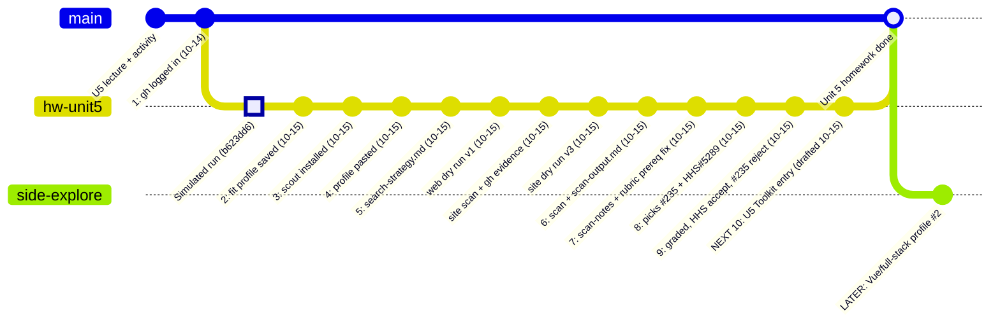
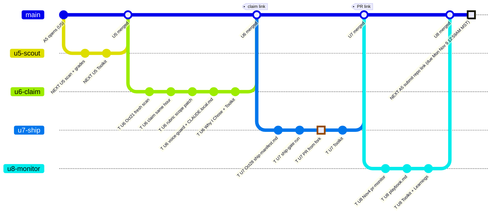
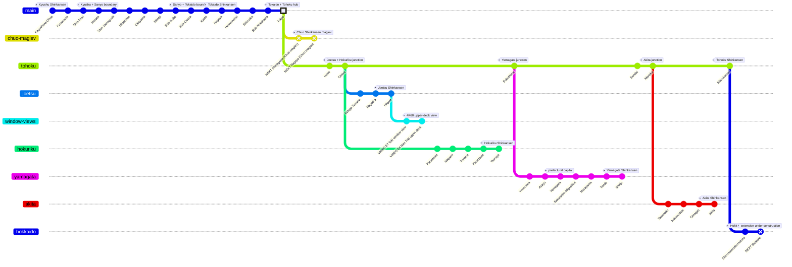

# AI301 status boards (2026-10-14)

Reuses the AI201 `docs/status` workstream-board pattern (zimmnotes `ai201-lab6-grocerylist-starter/docs/status`): one overview **gitGraph** per board, one **branch per workstream**, commit ids as milestone titles, states `done` / `open` (NEXT) / `blocked`. Like the AI201 boards, these are **conceptual workstreams, not repo commit history**. The older single board stays in [`2026-10-14-unit5-fit-profiles-and-status.md`](2026-10-14-unit5-fit-profiles-and-status.md#status-board-update-by-adding-commitsbranches).

**Live page (after push + Pages):** https://speculaas.github.io/ai301-coursework-trilogy-preview/status/ (`?board=unit5-homework`, `?board=beat2-a5`, `?board=roadmap-gitgraph`). Source: [`docs/status/`](../../docs/status/).

`T` = TENTATIVE (pre-release pages, as of 2026-10-14; may change). `NEXT` = open.

**How to update:**
- When a step finishes, drop its `NEXT` prefix and add the date or commit hash, e.g. `commit id: "2: fit profile saved (10-15)"`.
- New work goes in as new `commit` lines; side threads go in as new `branch` lines.
- Every commit id must be unique on the board (Mermaid rejects duplicates).
- If a step is blocked, change it to `BLOCKED: ...` and add `type: REVERSE`.

## Board 1: Unit 5 homework (steps 1-10, this week)

| Step | State | Where |
|---|---|---|
| 1 gh logged in | done | |
| 2-5 profile, scout install, search-strategy.md | NEXT | guide "Homework checklist"; draft in `2026-10-14-unit5-homework-simulated.md` |
| 6-7 scan + scan-output.md | NEXT | same |
| 8-9 2-3 Issue Selection site picks graded | NEXT | same |
| 10 Toolkit entry | NEXT | same |

## Board 2: Beat 2 / Assignment 5 (U5-U8, one submission)

A5 (250 pts) is one repo-link submission after U8: due **Mon Nov 9, 12:59 AM MST** (Sunday night). Don't claim before U6.

## Fun twist: Japan Shinkansen map as gitGraph

Same viewer, no course content: Shinkansen lines are branches and stations are commits in geographic order. The conceptual trunk is re-rooted south-to-north from Kagoshima-Chuo through Hakata, Shin-Osaka, and Tokyo, placing Tokyo nearer the visual center in both LR and TB views. Joetsu/Hokuriku diverge at Omiya, Yamagata at Fukushima, Akita at Morioka, Hokkaido at Shin-Aomori, and the future Chuo maglev at Tokyo. The `window-views` branch adds two intentionally non-station video bubbles at Niigata. `NEXT` + `type: REVERSE` means not yet open. Live board: `?board=shinkansen` (data: `docs/status/data/shinkansen.json`). Not to scale; not every station.

Orbit prompts (verbatim M365 bundle extracts, reusable paste-text): [`prompts/PROMPT_orbit_m365.md`](prompts/PROMPT_orbit_m365.md) · [`prompts/PROMPT_orbit_followup_m365.md`](prompts/PROMPT_orbit_followup_m365.md) — paste into M365 together with the corresponding `BUNDLE_*.txt`, or regenerate the bundle.

