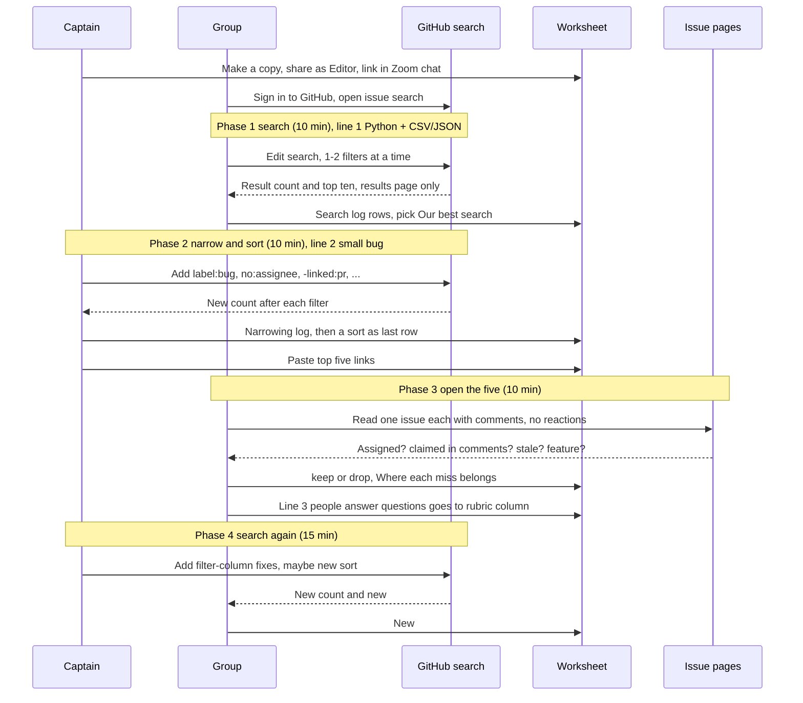
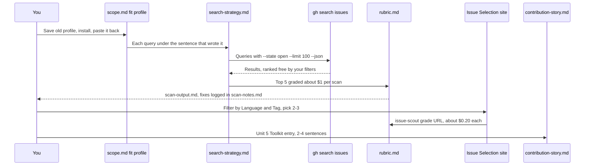

# Unit 5 activity — Find Five Worth Grading

**Date:** Wed Oct 14, 2026, 4:00 PM MDT (America/Denver) · preview note written the night before
**Scope:** coach / preview note (`beat-2-contribution/unit-5/` in
[`speculaas/ai301-coursework-trilogy-preview`](https://github.com/speculaas/ai301-coursework-trilogy-preview)).
**User:** Yie Sheng Chen / GitHub `speculaas` · Beat 2 opens; Unit 4 PR already open
([codepath/pathreview-ai301-fa26-s1#181](https://github.com/codepath/pathreview-ai301-fa26-s1/pull/181)).

> **Worksheet access:** the Activity worksheet (Google Doc) is access-restricted ("You need access")
> until the captain copies it in the session. The sample fit profile lines below come from the Activity tab;
> the filter key comes from the lecture slide, which the slides say matches the worksheet's key.

## Source table

| Source | Path (zimmnotes `chat/codepath/ai301/`) |
|---|---|
| Slides + speaker notes | `beat-2-contribution/unit-05/AI301 L5 _ Fa26 S1.txt` |
| Overview / Activity / Assignment tabs | `beat-2-contribution/unit-05/Overview-Activity-Assignment.txt` |
| Starter (local clone, not committed) | `beat-2-contribution/unit-05/ai301-unit5-starter/skill/{SKILL,scope,search-strategy}.md` |
| Copilot bundle (local only) | `beat-2-contribution/unit-05/copilot-pack-unit5/BUNDLE_unit5_lecture.txt` |
| Unit 4 style reference | [`../../beat-1-sandbox/unit-4/2026-10-13-unit4-activity-today.md`](../../beat-1-sandbox/unit-4/2026-10-13-unit4-activity-today.md) |

## Session timeline (120 min, starts 4:00 PM MDT)

| Block | Min | Clock (MDT) |
|---|---|---|
| Intro: welcome to Beat 2, "the issues are real" | 10 | 4:00–4:10 |
| Lecture: the wild's rules, your scout, Assignment 5 | 45 | 4:10–4:55 |
| Break | 5 | 4:55–5:00 |
| Activity: Find Five Worth Grading (breakouts) | 50 | 5:00–5:50 |
| Wrap-up: the one date, tonight's working time | 10 | 5:50–6:00 |

Activity inside: setup 5 · search 10 · narrow and sort 10 · open the five 10 · search again 15.

## Lecture key points

1. **Sandbox vs. the wild.** Sandbox: claims never blocked anyone, staff answered within days, 72 pre-vetted issues. Wild: claims count for everyone upstream, maintainers are strangers and silence is normal, the repo's own written rules are the standard. Opening example: sktime PR 10869 (first contribution, +13 lines, 1 file): plan-shaped description, decisive evidence, clean diff. "Same discipline, bigger room."
2. **Claim etiquette.** Read CONTRIBUTING.md, the templates, and any AI policy before posting. Your claim comment *is* the claim signal that other people's scouts read. Nothing reserves an issue: claim the moment you select it. How to word a claim is Unit 6; claiming early is allowed if you're sure.
3. **Read less, on purpose.** Spend your orientation budget in the subsystem the issue touches. A tightly scoped issue is the best first issue. Whole-repo orientation (repo memory file) is next week.
4. **gh CLI, four verbs:** `gh search issues` (read), `gh issue comment` (write, Unit 6), `gh pr create` (write, Unit 7), `gh pr view` (read, Unit 8). Setup: `gh auth login` once, then `gh auth status`.
5. **The scout funnel.** `gh search issues`, wide and **free** → rank using only result fields + fit profile, **free** → grade the **top 5** with your Unit 1 `rubric.md`, the only paid stage at **~$0.20 each**, about $1 a scan against the $50 monthly credit. The eval is unchanged and never reads the search machinery.
6. **Queries trace to the fit profile.** Each `gh search` line sits under the profile sentence that wrote it. "A query you can't trace to your profile is someone else's query." The browser search bar and `gh` run the same search: filters become flags, and the Sort by menu does the job of `--sort`. gh needs `--state open --limit 100` (otherwise it returns closed issues and stops at 30), and negations go after `--`, as in `-- -linked:pr`.
7. **Ranking rules.** Use free result fields only (title, repo, labels, assignees, comment count, updatedAt). Staff demo: 298 results → drop assigned → drop quiet 90 days → drop repeat repos → **newest first** → 5. At least one rule must be an **ordering** or a stated tie-break. "If deciding a filter would need the issue page, it is a rubric check wearing the wrong hat."
8. **Why the real issue comes from the Issue Selection site** (open-source-issue-tracker.onrender.com): (1) partner maintainers expect first PRs, (2) grading costs credit you need for Units 6–8, (3) search stays the skill you keep. The site does the finding and your rubric does the judging. A site claim reserves an issue from classmates, not from the world, and posts nothing on GitHub. Grade with `claude "issue-scout: grade <URL>"` and save the read-out to `scan-output.md`.
9. **Governance.** Rule 1: patching a validated tool is allowed, but write it down in the Toolkit block (what it produced / what fought me / what I changed). Rule 2: nobody grades your taste. No answer key exists; you're graded on telling the story honestly. Disagreeing with your tool is fine if you say why.
10. **Assignment 5:** `beat-2-contribution/contribution-story.md`, 250 pts, submitted once by Mon Nov 9, 12:59 AM MST (end of Unit 8). Points: **format 30 · selection 50 · repro + plan 50 · PR + evidence 60 · Toolkit thread 40 · learnings 20**. The PR is graded as opened, with no merge needed. If an instructor vetoes your issue, you pick again.

## Activity flow



## Mapping to the homework pipeline



## Per-phase searches and things to say

**Phase 1 — line 1: "I write Python and like working with data files such as CSV and JSON."**

- Start broad: `is:issue is:open language:python csv OR json`. Without `OR`, it needs both words.
- Tighter: `is:issue is:open language:python csv OR json label:"good first issue"`
- Title-only variant: `is:issue is:open language:python csv in:title label:"good first issue"`
- Log the search, its count, and whether the top ten fit. Decide from the results page only.
- *Say:* "Without `in:title`, 'json' matches every issue that pastes a JSON traceback. Let's compare counts with and without it."
- *Say:* "`language:` is the repo's main language, not the issue's, so a Python repo can still give us a JS issue."

**Phase 2 — line 2: "a small bug fix I can finish in two weeks, not a new feature."**

Add filters one at a time and log the count after each:
1. `label:bug` (or `-label:enhancement -label:feature`)
2. `no:assignee`
3. `-linked:pr`
4. `archived:false`
5. `updated:>2026-09-01`, to drop quiet issues
6. optional: `comments:<10`

Then pick a sort. **Recently updated** goes with the staff "newest first", and **Fewest comments** is a proxy for "small and unclaimed".
- *Say:* "'Small' and 'two weeks' aren't filterable. Only `bug` vs. feature is, so the rest goes to the rubric."
- *Say:* "Let's add `no:assignee -linked:pr` first, since the results page can't show either and they're free to filter."

**Phase 3 — open the five.** Read yours, comments included, with no comments or reactions. Sort each miss into a column:

| A search filter can catch it | Only the rubric can catch it |
|---|---|
| already assigned (`no:assignee`) | someone claimed it in a comment |
| PR already open (`-linked:pr`) | not finishable in two weeks |
| archived or stale repo (`archived:false`, `updated:>`) | no clear repro steps |
| labeled feature/enhancement (`label:bug`, `-label:enhancement`) | maintainers say "won't fix" / design undecided |
| too much discussion (`comments:<10`) | **line 3: "people answer questions"** (no filter checks maintainer responsiveness) |

- *Say:* "Line 3 goes in the rubric column. `comments:` counts comments but can't tell whether a maintainer replied."

**Phase 4 — search again.** Add the filter-column fixes you didn't have yet, maybe switch the sort, and judge the new #1.
- *Say:* "Did it help? The count dropped from X to Y, and #1 is a keep or drop because ... Next we'd change ... ."

**Finished early:** filter the Issue Selection site with the sample profile, but **don't click Claim**, and compare it with your top five.

## Homework checklist (Assignment tab, steps 1–10; nothing due this Sunday)

- [ ] 1. `gh auth status`. If gh is missing, install it from cli.github.com, then run `gh auth login`.
- [ ] 2. Copy the fit profile sentences out of `~/.claude/skills/issue-select/scope.md`.
- [ ] 3. Install from the `ai301-unit5-starter` clone:
  `cp skill/SKILL.md skill/scope.md skill/search-strategy.md ~/.claude/skills/issue-select/` then
  `mv ~/.claude/skills/issue-select ~/.claude/skills/issue-scout`. Check that `rubric.md` and `references/evidence-guide.md` are still there.
- [ ] 4. Paste the profile into the new `scope.md`, replacing "(Paste your fit profile here.)".
- [ ] 5. Fill in `search-strategy.md`:
  - at least 1 query (`--state open --limit 100`), each under the profile sentence it came from
  - at least 1 ranking filter on result fields, with at least 1 ordering
  - keep top-N at 5
  - run each query in the terminal first
- [ ] 6. `claude "issue-scout: run a scan"` (~$1). Save the read-out, from the summary through the JSON fence, to `scan-output.md`.
- [ ] 7. Fix `rubric.md` or `search-strategy.md` where it's wrong, and add dated lines to `scan-notes.md`. "Nothing broke" is fine if you can say how you know.
- [ ] 8. Pick 2–3 issues on the Issue Selection site using the Language/Tag (and Organization) filters. Claiming on the site is optional and posts nothing upstream.
- [ ] 9. `claude "issue-scout: grade <URL> <URL>"` (~$0.20 each), then append the result to `scan-output.md`.
- [ ] 10. In `contribution-story.md`, write the Unit 5 Toolkit entry: keep "Unit 5:" in the heading, then 2–4 sentences on what you built, what fell short, and what you changed.

## Candidate check: storytold/gridcraft (open-source Excel clone)

| Signal | Reading |
|---|---|
| Language | Rust, which doesn't match a Python-shaped profile unless yours names Rust |
| Age / stars | created 2026-10-07, ~4.5k stars in a week (viral launch) |
| Issues | ~590 open, almost no labels, so `label:bug` / `"good first issue"` searches find nothing |
| PRs | mostly a flood of agent-generated PRs, so race risk is very high and "claim the moment you select" is hard to honor |
| Rules | no CONTRIBUTING.md, and `AGENTS.md` is aimed at AI agents, so the "repo's written rules" are thin |
| Course fit | **not on the Issue Selection site**, so it needs instructor approval ("If your scan found an issue you'd rather do, ask your instructor") |

**Take:** it's interesting as a scan target to practice on (it shows why `no:assignee`/`-linked:pr` and a "people answer questions" rubric check matter), but it's a poor *first* real issue. The maintainers aren't course partners, triage is unknown, and you'd be racing bots. Use the site for the graded pick. If you still want gridcraft, ask the instructor and log the reasoning in the Toolkit entry.

## Rehearsal worksheet
Pre-filled mock worksheet with real counts and issues: [2026-10-14-unit5-worksheet-mock.md](2026-10-14-unit5-worksheet-mock.md)

## Candidate check: yt-dlp/yt-dlp (checked 2026-10-14, ~5:10 PM MDT)

- Python, ~198k stars, ~2,700 open issues, active (last push 2026-10-10).
- Only **1** open `good first issue`.
- `CONTRIBUTING.md` has a **NO AI / NO LLM POLICY**: no LLMs, agents, or AI tools for any contribution, including issues, bug reports, patches, PRs, and PR descriptions.
- Not on the AI301 Issue Selection site.

**Take:** not a fit for AI301. The course workflow (issue-scout, voice-guard, ship-gate, the AI-use line in the PR) conflicts with the repo's written rules, so any PR would break them. It's a good discussion example for "read the repo's written rules before you post" (lecture: etiquette in writing), and a reason for a rubric or scope check on `CONTRIBUTING.md` AI policies.

## Takeaways from the M365 Copilot study session (2026-10-14)

**Search caution:** with `OR`, use parentheses: `is:issue is:open language:python (csv OR json) label:"good first issue"`. Without them, the `OR` can split the whole query.

**Ranking rule or rubric check?** Rules that use free result fields are fine for ranking: drop assigned, drop quiet for 90 days, one per repo, fewest comments then newest update, prefer `bug` + `good first issue`. These are rubric checks in disguise, because you have to open the issue or repo to judge them:
- clear repro steps
- fix touches 1–2 files or is finishable in two weeks
- responsive maintainers (profile line 3)
- someone already claimed it in the comments
- simple setup
- unresolved design questions
- repo forbids AI-assisted contributions

**Repo policy gate (patch idea, from the yt-dlp check):**
- scope.md: before grading a URL, claiming, commenting, or contributing, read `CONTRIBUTING.md`, `README.md`, `.github/`, the templates, and any AI/LLM policy. If the intended AI-assisted workflow is forbidden, stop and treat the repo as out of scope. If it's unclear, don't post until it's resolved.
- rubric.md (required): *Repository contribution policy permits my intended workflow.* Pass if the written rules allow it, fail if they prohibit it, unclear if no policy is found.
- Not search-strategy.md, because search results can't show a repo's policy.

**Draft Unit 5 Toolkit entry (rewrite in your own words):** Added a repo-policy gate to issue-scout. Checking yt-dlp showed that technical fit isn't enough: its CONTRIBUTING.md forbids any AI/LLM help, which rules out the whole course workflow. I added a required check to read a repo's contribution and AI-use rules before interacting, and to stop when they prohibit it.

**Self-quiz answers:** search, then rank, then the top five, then rubric grading. Five graded at about $0.20 each is about $1 a scan. The real issue comes from the Issue Selection site. Assignment 5 is 30 + 50 + 50 + 60 + 40 + 20 = 250.

## Live-session notes (2026-10-14, Phase 1)

**Gotcha: use the right search page.** `github.com/issues` is your personal dashboard. Its sidebar views ("Assigned to me", "Created by me", "Mentioned") stay highlighted while you type a search, which is confusing, and the query may not run as typed. Use the global issue search instead: https://github.com/search?type=issues

**What a dropped keyword looks like:** a run where `(csv OR json)` didn't apply returned **78,416** results. The top ten were new issues of every kind, and only 1 of 10 (myrtia#46, a CSV export test) fit line 1. Log row: "78k; top ten mostly don't fit line 1. Only 1/10 is CSV/JSON; the rest are any newly opened issue."

**Search terms:**
- `in:title`: the words must appear in the issue title, not just the body or comments. Results fit better but there are fewer. gh: `--match title`.
- Combining filters: put them side by side with spaces (an implicit AND). Quote labels that contain spaces.
- Suggested Phase 1 search: `is:issue is:open language:python (csv OR json) in:title label:"good first issue"`
- "Do the top ten fit line 1?" means: do the first ten results match profile line 1 (Python + CSV/JSON data files)? Answer in one sentence, e.g. "8 of 10 are CSV/JSON bugs in Python repos."
- Logging means adding a row (name, the whole search, result count, one-sentence fit) to the Search log in the **captain's** shared doc.

**The same search in gh (homework form):**
```
gh search issues --match title --language python --label "good first issue" --state open --limit 30 -- csv OR json   # keywords unquoted: a quoted "csv OR json" is searched as one exact phrase and returns 0
```

## Homework rehearsal (simulated)

See [2026-10-14-unit5-homework-simulated.md](2026-10-14-unit5-homework-simulated.md): a labeled-simulated walkthrough of steps 1–10, with real `gh` counts and a top five.

## Fit profiles + status board

See [2026-10-14-unit5-fit-profiles-and-status.md](2026-10-14-unit5-fit-profiles-and-status.md): Vue/TypeScript/Node/full-stack notes, an exploratory profile diagram, and a gitGraph status board.

## Course roadmap

See [2026-10-14-ai301-roadmap.md](2026-10-14-ai301-roadmap.md).
