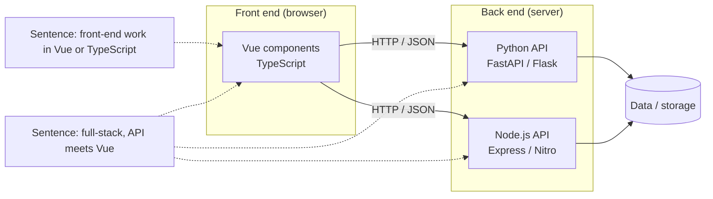
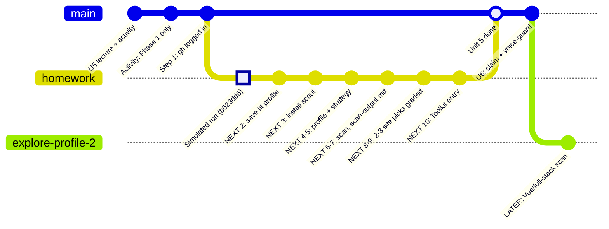

# Unit 5: fit profiles (main + exploratory) and status board

Discussion notes, 2026-10-14 evening.

## Vue, TypeScript, Node.js, full stack: what the words mean

- **Vue** is a JavaScript framework for the **front end**: what runs in the browser (components, UI). Many Vue projects are written in **TypeScript** (typed JavaScript), and Vue 3 itself is written in TypeScript. Its creator is Evan You, who also made Vite.
- **Node.js** runs JavaScript or TypeScript **outside the browser**. That usually means the **back end** (APIs, servers), and it also runs front-end build tools such as Vite.
- **Full stack** means **front end + back end**: for example, a Vue UI calling a Python (FastAPI) or Node API.
- **GitHub search tip:** a Vue repo's language may show as `Vue` or `TypeScript`, so search `--language vue` and `--language typescript` separately.

## Profiles

| | Profile | Status |
|---|---|---|
| Main (graded pick) | the existing Python fit profile in `~/.claude/skills/issue-scout/scope.md` (storage/infra, ML/CV, Python) | use this for the Unit 5 to 8 contribution |
| Exploratory #2 | "I'd like front-end work in Vue or TypeScript." / "I'm open to full-stack issues where a Python/Node.js API meets a Vue web front end." | only after the main contribution, as exploration |

Rule: every query must trace to its own profile sentence, so the second profile gets its own queries rather than mixing them into the main one.

### Exploratory profile #2: where an issue could live



Draft queries, untested. Keywords go unquoted after `--`:

```
# from: "I'd like front-end work in Vue or TypeScript."
gh search issues --language vue --label "good first issue" --state open --no-assignee --limit 100 -- -linked:pr bug
gh search issues --language typescript --label "good first issue" --state open --no-assignee --limit 100 -- -linked:pr vue

# from: "I'm open to full-stack issues where a Python/Node.js API meets a Vue web front end."
gh search issues --language python --label "good first issue" --state open --no-assignee --limit 100 -- -linked:pr api frontend
```

## Status board (update by adding commits/branches)



**How to update it:** when a step finishes, drop its `NEXT` prefix and add the date or commit hash, e.g. `commit id: "2: fit profile saved (10-15)"`. Add new `commit` lines for new work, and new `branch` lines for side threads (for example, a rubric patch).

| Item | State |
|---|---|
| Lecture + activity (team stopped after Phase 1) | done |
| Step 1: `gh auth status` (speculaas, gh at /opt/homebrew/bin) | done |
| Simulated homework walkthrough | done (`2026-10-14-unit5-homework-simulated.md`) |
| Steps 2–3: save profile, install scout | next |
| Steps 4–5: profile + `search-strategy.md` | next |
| Steps 6–7: one scan (~$1) to `scan-output.md` | next |
| Steps 8–9: 2–3 Issue Selection picks, graded | next |
| Step 10: Unit 5 Toolkit entry | next |
| Exploratory Vue/full-stack profile | later |
