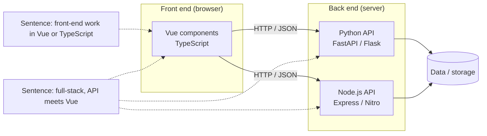
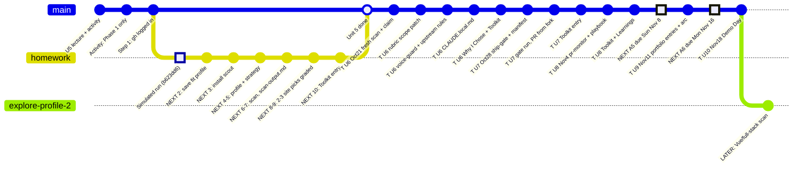

# Unit 5: fit profiles (main + exploratory) and status board

Discussion notes, 2026-10-14 evening.

## Vue, TypeScript, Node.js, full stack: what the words mean

- **Vue** is a JavaScript framework for the **front end**: what runs in the browser (components, UI). Many Vue projects are written in **TypeScript** (typed JavaScript), and Vue 3 itself is written in TypeScript. Its creator is Evan You, who also made Vite.
- **Node.js** runs JavaScript or TypeScript **outside the browser**. That usually means the **back end** (APIs, servers), and it also runs front-end build tools such as Vite.
- **Full stack** means **front end + back end**: for example, a Vue UI calling a Python (FastAPI) or Node API.
- **GitHub search tip:** a Vue repo's language may show as `Vue` or `TypeScript`, so search `--language vue` and `--language typescript` separately.

## Profiles

| | Profile | Status |
|---|---|---|
| Main (graded pick) | the existing Python fit profile in `~/.claude/skills/issue-scout/scope.md` (storage/infra, ML/CV, Python) | use this for the Unit 5 to 8 contribution |
| Exploratory #2 | "I'd like front-end work in Vue or TypeScript." / "I'm open to full-stack issues where a Python/Node.js API meets a Vue web front end." | only after the main contribution, as exploration |

Rule: every query must trace to its own profile sentence, so the second profile gets its own queries rather than mixing them into the main one.

### Exploratory profile #2: where an issue could live



Draft queries, untested. Keywords go unquoted after `--`:

```
# from: "I'd like front-end work in Vue or TypeScript."
gh search issues --language vue --label "good first issue" --state open --no-assignee --limit 100 -- -linked:pr bug
gh search issues --language typescript --label "good first issue" --state open --no-assignee --limit 100 -- -linked:pr vue

# from: "I'm open to full-stack issues where a Python/Node.js API meets a Vue web front end."
gh search issues --language python --label "good first issue" --state open --no-assignee --limit 100 -- -linked:pr api frontend
```

### Exploratory profile #2: more searchable sentences (added 2026-10-14)

Each sentence can become a query, so keep queries traced to these exact lines:

| Sentence | Query idea (keywords unquoted after `--`) |
|---|---|
| "I'd like Vue issues about how components fetch or show data, like state, forms, tables or API calls." | `--language vue -- state OR pinia OR fetch OR table` |
| "I'm interested in Python issues about packaging, CI, Docker or deployment." | `--language python -- ci OR docker OR packaging` |
| "…and Vue/Node build and deploy issues, like Vite config or CI." | `--language typescript -- vite OR build OR ci` |

## Learning goals (not fit-profile lines: no search can check them)

- Vue: why it was made (approachable, progressive, design-led) and its strengths vs. React/Angular; how it evolved (Vue 2 Options API to Vue 3 Composition API, TypeScript, Vite); its idioms (single-file components, reactivity, `ref`/`computed`, Pinia); and how it handles data (props/emits, stores, fetching from APIs).
- Python: the same questions about its idioms and data handling.
- DevOps behaviour of both: Python packaging/venv/uv, CI, Docker images; Node/Vite build output, bundling, deploys.
- Starting points: Vue's official docs and design notes; Evan You's v-conf Taiwan 2026 keynote (Oct 17, Taipei).
- These feed the profile: once a goal turns into a concrete kind of work, write it as a searchable sentence above.

## Using "why and how it evolved" (it can't be a ranking rule)

Ranking may only use fields the search returns (labels, comments, updated, assignees, repo), so "evolution" can't be ranked on directly. Two honest ways to use it:

1. **Label/keyword stand-in for ranking:** "prefer `docs`, `refactor` or `migration` labels first", or search keywords like `migration`, `deprecat`, `composition api`. These issues often touch how a project's design changed.
2. **Preferred rubric check** (lives in `rubric.md`, which already reads the issue page): *"Working on this issue would teach me something about why or how the project's design evolved."* Mark it **preferred**, not required, so it can't block a good pick.

## Status board (update by adding commits/branches)

Split boards (Unit 5 homework, Beat 2 / A5): [`2026-10-14-ai301-status-boards.md`](2026-10-14-ai301-status-boards.md).

`T` commits are TENTATIVE (pre-release pages, as of 2026-10-14; may change).

> **Note for future updates:** To update the board, drop a step's `NEXT` prefix and add the date or commit hash. New work goes in as new `commit` lines, and side threads, like a rubric patch, as new `branch` lines.



**How to update it:** when a step finishes, drop its `NEXT` prefix and add the date or commit hash, e.g. `commit id: "2: fit profile saved (10-15)"`. Add new `commit` lines for new work, and new `branch` lines for side threads (for example, a rubric patch).

| Item | State |
|---|---|
| Lecture + activity (team stopped after Phase 1) | done |
| Step 1: `gh auth status` (speculaas, gh at /opt/homebrew/bin) | done |
| Simulated homework walkthrough | done (`2026-10-14-unit5-homework-simulated.md`) |
| Steps 2–3: save profile, install scout | next |
| Steps 4–5: profile + `search-strategy.md` | next |
| Steps 6–7: one scan (~$1) to `scan-output.md` | next |
| Steps 8–9: 2–3 Issue Selection picks, graded | next |
| Step 10: Unit 5 Toolkit entry | next |
| Exploratory Vue/full-stack profile | later |
| TENTATIVE U6 (Oct 21): fresh scan, claim, rubric patch, voice-guard, CLAUDE.local.md | next |
| TENTATIVE U7 (Oct 28): ship-gate + ship-manifest.md, PR from fork when gate passes | next |
| TENTATIVE U8 (Nov 4): pr-monitor + playbook; **A5 due Sun ~Nov 8** | next |
| TENTATIVE U9 (Nov 11): portfolio; **A6 due Mon Nov 16, 12:59AM MST** | next |
| TENTATIVE U10 (Nov 18): Demo Day, ungraded | next |
