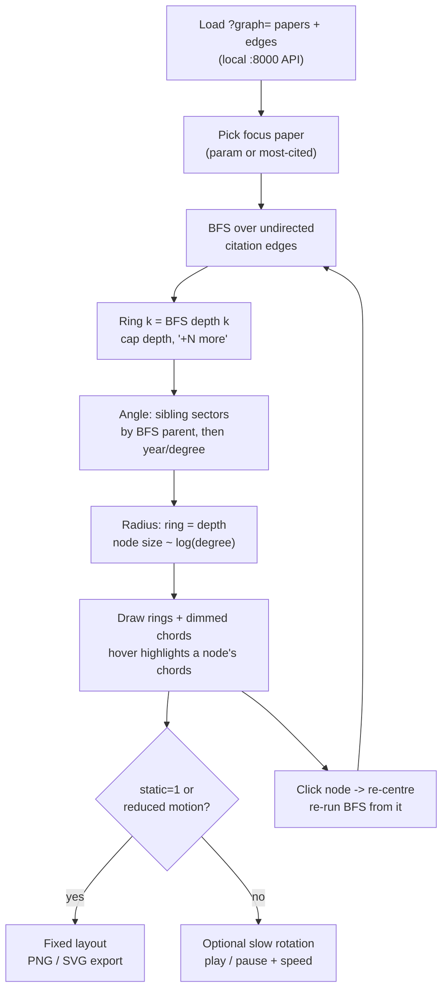

# Watch 7 — orbital renderer plan (design note, 2026-10-18)

Status: **plan only, not implemented.** Decision so far (Copilot v3, Part D): option C
(linked views) now, a real watch 7 later only with a concrete use case. This note is
that later design, kept next to the orbit notes so it is not lost.

Related: [`docs/orbit/`](../../docs/orbit/) (the Pages orbit explorer, Solar/Aurum/Animorphs),
`watch6-core.html?graph=work-threads` in the local bib-citation-graph app (`:8000`).

Copy also in bib-citation-graph at `docs/NOTE_watch7_orbit_plan_2026-10-18.md` (impl-repo copy, canonical for implementation; edit there and refresh this course copy).

## What "orbits" would imply for a citation graph

Orbits are **rings by graph distance**, not decoration:

- The focus paper sits at the centre (the "star").
- Ring *k* = papers at **breadth-first-search (BFS) distance *k*** from the focus,
  using **undirected** citation edges (cites + cited-by both count as one hop).
  Ring 1 = direct neighbours, ring 2 = neighbours of neighbours, and so on.
- So "orbital period / radius" has no meaning here — ring radius encodes BFS depth,
  angle encodes grouping (below), node size encodes degree. It is a radial BFS layout,
  not a physics simulation. Rotation, if any, is purely presentational.

## Design

- **New file only:** `watch7-core.html`; storage prefix `bcg.watch7`; renderer name
  `orbit`. Do **not** modify shared `watch-core.js` unless watch 2/4/6 get regression
  tests first (fork config, shared core untouched).
- **Data:** same `?graph=` papers/edges schema as watch 6, fetched from the local
  `:8000` API (`/api/...` as watch 6 does). No new backend endpoint expected.
- **Centre / re-centre:** focus paper at centre; clicking any node re-centres on it
  (re-run BFS from that node, animate/transition or just re-layout).
- **Rings:** BFS by undirected citation distance: depth 1, depth 2, … Cap the depth
  shown (suggest 3) and collapse the rest into a single `+N more` node/ring so dense
  graphs stay readable.
- **Angle:** group siblings together — papers sharing a parent (the node through which
  BFS first reached them) occupy a contiguous angular sector, ordered by year or degree.
- **Nodes:** radius ~ `log(degree)` (clamped), so hubs are visible without swamping.
- **Edges:** citation chords drawn dimmed by default; hovering/selecting a node
  highlights only its chords (full chord set is unreadable in dense graphs).
- **Motion:** rotation **off by default**. Play/pause + speed only rotate the whole
  ring angle slowly; nothing else moves. (Same lesson as the orbit page: motion is
  opt-in, pause is not a substitute for a static view.)
- **Static:** `?static=1` renders a fixed, deterministic layout (fixed epoch/angle,
  alphabetical tie-breaking) with no animation loop; PNG/SVG export button for
  papers/slides. `prefers-reduced-motion` defaults to static.
- **Keyboard:** arrow keys move within a ring (←/→) and across rings (↑/↓);
  Enter re-centres on the focused node; the selected paper syncs to the info panel.
- **Hosting — option C (linked views):** watch 7 lives on the local `:8000` server
  only (Pages cannot call the local API). GitHub Pages gets at most a clearly labelled
  local-only link (`http://127.0.0.1:8000/watch7-core.html?graph=work-threads`), and the
  local watch pages can link back to the published orbit page. Do not try to merge the
  planet canvas into the status-board gitGraph viewer, and do not map papers onto
  planets (that corrupts citation semantics — rejected in Copilot v3 Part D, options A/B).

## Layout sketch

## Open questions

- Depth cap and `+N more` behaviour on the real `work-threads` graph (measure ring sizes first).
- Whether re-centring should animate or snap (snap is simpler and static-friendly).
- SVG export fidelity for chords/labels at paper-figure size.

*Created 2026-10-18 (America/Denver). Linked from `docs/orbit/README.md`.*
