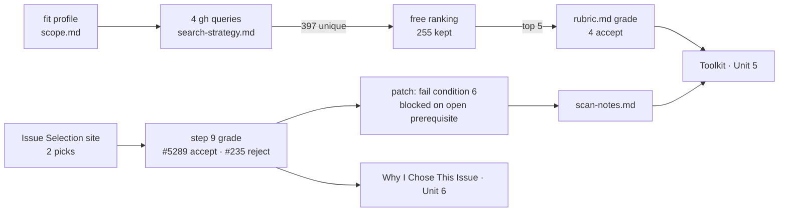

# Unit 5 lecture → contribution story map (2026-10-21)

How the Unit 5 lecture ("Into the Wild") lines up with my Unit 5 artifacts and with chapters of `contribution-story.md`. Slide titles are named and summarized in my own words; no slide text is copied here. The lecture text itself stays out of this repo.

## Slide → artifact → story chapter

| Lecture slide (title) | What it asks for, in short | My artifact | Story chapter it feeds |
|---|---|---|---|
| Tool governance, rule 1: "Patch it, write it down" | Each Toolkit entry gives what the tool produced, what fought me and what I changed, with concrete numbers | `~/.claude/skills/issue-scout/scan-notes.md` (dated lines) | **Toolkit → Unit 5** (40 pts) |
| Search strategy, part 2: "Rank cheap, grade last" | Free filters on returned fields only, at least one ordering, and only the top five get paid grading. Staff demo: 298 results → 5 | `search-strategy.md`; my scan: 397 → 255 kept → 5 graded (4 accept) ([snapshot](2026-10-15-scan-output-snapshot.md)) | Toolkit, "what it produced" |
| Search strategy, part 1: "Your fit profile becomes queries" | Every query should trace back to one sentence of the fit profile | `scope.md` fit profile + four queries ([homework note §2–3](2026-10-14-unit5-homework-simulated.md)) | Why I Chose This Issue (selection, 50 pts) |
| "The capability" / "A skill that feeds itself" | Install issue-scout over the Unit 1 skill. The eval still grades only with the Unit 1 rubric | `~/.claude/skills/issue-scout/` install | Toolkit, "what I built" |
| "Why the site, not the scout" / "The site, then your rubric" | The real issue comes from the Issue Selection site; grade 2–3 picks and save the read-out to `scan-output.md` | `scan-output.md` step 9 read-out: #5289 accept, #235 reject | Why I Chose This Issue |
| Tool governance, rule 2: "Nobody grades your taste" | You're graded on telling it honestly. Disagreeing with your own tool is fine if you say why | opengris-scaler #235 (my favourite) rejected, then the rubric patch | Toolkit, "what fought me"; full account in Why I Chose This Issue |
| "Read the rules, claim your issue" | Read README, CONTRIBUTING and any AI policy before posting; the upstream claim comment is the real claim | AI-policy check in `rubric.md`; CLA/DCO gap from the dry runs | Learnings and Reflections; Unit 6 claim |
| "Read less, on purpose" | A tightly scoped issue keeps the reading small | the "touches more than 8 files" strike against #235 | Solution Approach (later) |
| "Assignment 5 · the terms" | 250 pts, one repo link, due Sunday of unit 8 (Mon Nov 9 12:59 AM MST) | ai301-coursework repo | all chapters |
| (whole lecture) | — | — | **Resources Used**: cite "AI301 Unit 5 lecture, Into the Wild" by title only |

## What this means for the Unit 5 entry

- Write it as the three beats from rule 1: what it produced, what fought me, what I changed, one sentence each, with real numbers.
- Mention the #235 disagreement in a single clause in the Toolkit entry, and save the full story for Why I Chose This Issue in Unit 6.
- The draft is in [homework note §7](2026-10-14-unit5-homework-simulated.md#7-draft-unit-5-toolkit-entry-rewrite-in-your-own-words) ("three-beat version").
