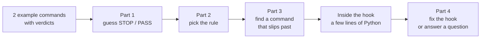

# Crack the Hook: SIMULATED breakout game (2026-10-21)

> **Simulated.** I skipped the Unit 6 breakout room. This is a solo replay of the game from the cloned repo ([smoran02/ai301-unit6-crack-the-hook](https://github.com/smoran02/ai301-unit6-crack-the-hook), commit `f10d3ff`), not a record of what my room did. Spoilers below: the README asks players not to open `levels.dat`, and this note gives away every answer.

## How I ran it (free, offline)

- I copied the game to `/tmp/cth`, not inside the course repo. The game warns if it finds itself inside another git repo, and the README says to commit nothing from it.
- `python3 play.py` with answers piped in from a file, using Mac `python3` 3.9.6. The game needs Python 3.8 or newer, uses no Claude credits, and never runs the commands. It passes each command string to a real hook script as Claude Code would, `{"tool_name": "Bash", "tool_input": {"command": ...}}` on stdin, and reads the exit code: **2 = STOP, 0 = PASS**. Any other exit code (a crash) is treated as PASS, like Claude Code does.
- For Part 4 I put fixed hooks in `my-hooks/level1.py` and `my-hooks/level3.py` before starting, so the game tested them with its own checklist.
- **Result: 22 of 22 points** (level 1: 8/8, level 2: 7/7, level 3: 7/7). Both fixes passed the game's test suite.

## The shape of every level

Only first-try answers score. On the live call the captain shared a screen and the room agreed on each answer. Part 4 was the one part everyone did on their own laptop.

## Level 1: "no pushes to main" (8 points)

Setup: my fork of a project called `tidyfeed`, with branches main, fix-typo and docs-update.

| Command | Hook says | Why |
|---|---|---|
| `git push origin main` (example) | STOP | push + the word main |
| `git push origin fix-typo` (example) | PASS | push, but no main |
| `git push origin docs-update` | PASS | same |
| `git pull origin main` | PASS | not a push |
| `git commit -m "Fix typo"` | PASS | not a push |
| `git push origin main --force` | STOP | push + main |
| `git checkout main` | PASS | not a push |

- **Rule:** it stops pushes that name main (or master). It doesn't stop every push or every mention of main.
- **The slip:** `git push --all origin` pushes every branch, main included, but the word main never shows up, so it gets PASS.
- **Inside:** `words[:2] == ["git", "push"] and ("main" in words or "master" in words)`, then `return 2`.
- **My Part 4 fix:** add `or "--all" in words` to that condition. The game re-ran all 8 commands: the 3 that should STOP did, and the 5 that should PASS did.
- **Still leaks (my reasoning, not tested in the game):** `git push origin HEAD:main` and `git push origin fix-typo:main` pass the word `HEAD:main` as one token, not `main`, so they still PASS. So does a bare `git push` while you're on main. Word matching can't see what a refspec or the current branch resolves to.

## Level 2: "no comments on an issue someone else is assigned to" (7 points)

Setup: I'm `@you`. #3 is assigned to `@dana-dev`. #5 is unassigned, but `@lee-codes` has commented "Can I take this?". #8 is unassigned. #11 is assigned to me.

| Command | Hook says | Why |
|---|---|---|
| comment on #3 "Can I take this?" (example) | STOP | #3 is someone else's |
| comment on #8 "Can I take this?" (example) | PASS | nobody is assigned |
| comment on #11 "Almost done." | PASS | it's mine |
| `gh issue view 3` | PASS | viewing, not commenting |
| comment on #3 "Is this still a bug?" | STOP | the hook doesn't read the text, only whose issue it is |
| comment on #3 "Thanks, Dana!" | STOP | same |

- **Rule:** it stops comments on issues assigned to someone else. It doesn't stop "comments asking to take an issue" or "any issue with an assignee".
- **The slip:** "Can I take this?" on **#5** gets PASS. Nobody is assigned, but `@lee-codes` already claimed it in a comment, and the hook never reads comments.
- **Part 4 is a question here, not a fix.** Suppose the hook greps the comments for "Can I take this?". Which claim does it still miss? Answer: **"I'd like to work on this one."** People word claims many ways, so telling a claim from a question takes judgment, and word matching can't supply it.
- The game's side note: a thank-you should come from you, typed on the issue page, not from an AI tool.

## Level 3: "every pull request has an `AI use:` line" (7 points)

Setup: on branch fix-link, about to open a PR.

| Command | Hook says | Why |
|---|---|---|
| `gh pr create ... --body "Fixed the link."` (example) | STOP | no `AI use:` |
| `gh pr create ... --body "Fixed the link. AI use: none."` (example) | PASS | has it |
| `gh pr list` | PASS | not a create |
| `gh pr create ... --body "AI drafted the tests."` | STOP | an honest note, but not the exact words |
| `gh pr comment 4 --body "Thanks for the review!"` | PASS | a comment, not a create |
| `gh pr create ... --body "AI use: Claude drafted them."` | PASS | has it |

- **Rule:** it stops a new PR whose `--body` lacks the literal `AI use:`. It doesn't check "mentions AI", and it doesn't check comments.
- **The slip:** `gh pr create --title "Fix typo" --web`. The description gets typed in the browser, the hook finds no `--body`, and it returns 0.
- **Inside:** `if body is None: return 0`, which fails open.
- **My Part 4 fix:** in that branch, print a reason to stderr and `return 2`, so it fails closed when there's nothing to read. The game's checklist passed.
- **Side effect worth knowing:** my fix would also stop a legitimate `--body-file pr.md`, because this toy hook only knows `--body`/`-b`. The real voice guard (`check_voice.py` in the starter) handles this properly. It reads `--body-file` from disk, stops `--web`, stops `--body-file -` (stdin) and stops body-less forms. That's why INSTALL step 5's wiring test (`gh issue comment --help`) is *supposed* to be stopped.

## What the game teaches (in my words)

1. **A hook reads the words of a command, not what it does.** Each slip is something the words leave out: a branch hidden in `--all`, a claim made in a comment, a description typed in the browser.
2. **Exit codes are Claude Code's contract.** 0 means PASS, 2 means STOP and the stderr goes back to Claude, and anything else (a crash) lets the command run. A crashing guard protects nothing. Git's own hooks are different: they stop on any non-zero exit.
3. **Fail closed when you can't see.** Level 3's fix and the real voice guard both stop what they can't read.
4. **Judgment needs a model; exact formats need a template.** Level 2 can't be fixed by matching words. The voice guard handles it by handing the text to a model (`claude -p --model sonnet` inside `check_voice.py`). Level 3 works only because the repo's PR template fixes the wording (`AI use:`).
5. **Test a check both ways,** on things it should stop and things it should let through, the way the game's Part 4 test suite did.

## Activity tab question: "when you post your claim this week, what will you still have to check yourself?"

My answer, for #235 or #5289:

- **Every comment on the thread,** for a claim in other words, like level 2's #5. The guard only checks *my* words. The rubric's `not-already-taken` only checks assignees and open linked PRs.
- **Whether the issue is still real today.** For #5289 that means whether the browserslist warning still appears in a frontend build.
- **The repo's CONTRIBUTING.md and AGENTS.md** (opengris forbids an AI co-author trailer; FINOS needs a CLA).
- **Anything I post from the browser,** which the hook can't see. Run `python3 ~/.claude/voice-guard/check_voice.py --draft claim-draft.md` first.

## Links to the rest of Unit 6

- Homework path: [2026-10-21-unit6-homework-path.md](2026-10-21-unit6-homework-path.md)
- Hook background reading and concurrency notes: [2026-10-21-unit6-extra-materials.md](2026-10-21-unit6-extra-materials.md)
