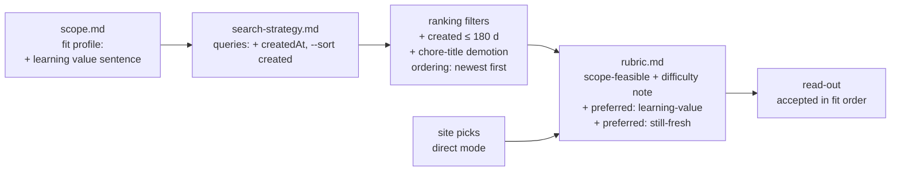

# Proposal: add "learning value", "manageable" and "new" to my scout (2026-10-21)

**Status: proposal only.** I haven't edited `~/.claude/skills/issue-scout/`. Below are the files that would change, the draft text, and how my two current picks would fare. It's based on reading my installed `scope.md`, `search-strategy.md`, `rubric.md`, `scan-notes.md` and `SKILL.md` tonight.

## Where each idea belongs (the rule that decides)

The scout has three layers, and each idea fits in exactly one of them. The Unit 5 rule: **if deciding a filter needs the issue page, it's a rubric check, not a ranking filter.** Ranking is the free stage; the rubric is the paid one.

| Idea | Can the search-result fields decide it? | So it goes in | Notes |
|---|---|---|---|
| **New** (recent) | Yes: `createdAt` and `updatedAt` are result fields | `search-strategy.md`: query flags + ranking filter / ordering | Free. Doesn't touch site picks |
| **Manageable** (a size I can learn from, not cramming) | Only weakly (comment count, labels like `size:S`) | Mostly the **rubric**: it's what the Unit 6 staff patch's `scope-feasible` + **difficulty note** already measures | Reading files touched and open edges needs the page and code, so it's paid |
| **High learning value** | A rough proxy only (titles that read as pure chores) | `scope.md` fit profile sentence + a **preferred** rubric check; optionally a title-based ranking demotion | Subjective, so it never decides accept/reject |



**Important for this week:** my Issue Selection site picks are graded in **direct mode**, with the URLs handed straight to the rubric. Search and ranking changes (anything in `search-strategy.md`) **never touch them**. Only rubric changes show up on #235 and #5289. Per `SKILL.md`, the fit profile and preferred checks also affect the **order** in which accepted direct picks are listed, never the verdict.

## Draft changes, file by file

### 1. `scope.md`: fit profile (one sentence edited, one added)

The current profile says I'm "also interested in light CI/tooling and dependency or config hygiene when the ticket is clearly scoped". That's the sentence that let a browserslist bump look like a fit. Proposed:

```diff
- ... also interested in light CI/tooling and dependency or config hygiene when the ticket is clearly scoped.
+ ... also open to light CI/tooling or config work when it changes behavior I can test, not a version bump alone.
+ Prefer issues with learning value for me: I change real Python code paths and add or update a test, in an
+ area I want to grow in (backend, storage, ML-CV), sized so I can understand the whole change within two
+ weeks, and opened or confirmed by a maintainer recently. Pure dependency/lockfile bumps are a last resort.
```

This sentence then becomes the "From:" trace for the new filters below. A query or filter that can't name its profile sentence isn't mine.

### 2. `search-strategy.md`: "new" as free filters

Queries. Add `createdAt` to every `--json` list so the ranking can see it. On two of the four queries, ask GitHub for the newest first, so the 100-result cap stops being a best-match slice (that's the 2026-10-15 scan-notes problem):

```diff
- gh search issues --language python --label "good first issue" --state open --no-assignee --updated ">2026-08-15" --limit 100 --json title,repository,labels,assignees,commentsCount,updatedAt,url -- storage OR s3 OR cache -linked:pr
+ gh search issues --language python --label "good first issue" --state open --no-assignee --created ">SCAN_DATE_MINUS_180D" --sort created --order desc --limit 100 --json title,repository,labels,assignees,commentsCount,createdAt,updatedAt,url -- storage OR s3 OR cache -linked:pr
```
(`gh search issues --help` on my Mac lists `--created`, `--sort created` and the `createdAt` field. `SCAN_DATE_MINUS_180D` is computed at scan time, which also fixes the hard-coded `2026-08-15` drift logged on 10-15.)

Ranking filters:

```diff
  3. Drop any result not updated since 2026-08-15 (about 60 days).
+ 3. Drop any result not updated in the 60 days before the scan date (relative, not hard-coded).
+ 3b. Drop any result created more than 180 days before the scan date ("opened ... recently").
+ 5b. Demote (move to the bottom, don't drop) results whose title reads as a pure chore:
+     bump | upgrade .* to | update (deps|dependencies|lockfile|browsers?list|caniuse) | renovate | dependabot
+     ("Pure dependency/lockfile bumps are a last resort").
- 6. Order: fewest comments first; tie-break, `bug` label before no `bug` label; then most recently updated first.
+ 6. Order: fewest comments first; then `bug` label first; then newest created first; then most recently updated.
```
- The regex needs `browsers?list`: #5289's actual title is "Update **browserlist**", a misspelling that a strict `browserslist` pattern would miss.
- **This conflicts with an older proposal.** On 2026-10-15 `scan-notes.md` proposed the tie-break "size:S/docs labels first, then **oldest** created". Choosing "newest created" overrides that, so the new dated line should say the older proposal is superseded.

### 3. `rubric.md`: "manageable" and "learning value" (after the Unit 6 staff patch)

Do the staff patch first (Assignment step 3). That gives **`scope-feasible`** (required) plus the **difficulty note** (straightforward / moderate / ambitious), and the difficulty note *is* the manageability signal. It's information for the chooser and never an input to the verdict. Then add two **preferred** rows. Preferred, not required, because:
- the course says "nobody grades your taste", and learning value is taste;
- preferred checks never change accept/reject, so the Unit 1 gold-label agreement stays the same. A new *required* row would mean re-checking with the paid Unit 1 harness.

| Check | Evidence | Pass condition | Weight |
|---|---|---|---|
| learning-value | Issue body + labels; live: the files the proposed change would touch | **Preferred** if the change edits executable logic (not only a version pin, lockfile or generated file) in an area named in my fit profile, and the fix would come with a new or updated test. Never changes accept/reject. | preferred |
| still-fresh | Issue `createdAt`, the latest human (non-bot) comment or maintainer label change; live: reproduce note in the body | **Preferred** if created within 180 days **or** a maintainer or human confirmed the problem within 60 days. Otherwise the read-out says "stale: re-verify before claiming". Never changes accept/reject. | preferred |

Optional, for "manageable" beyond the difficulty note, as a line in my *choice* rule rather than the rubric: prefer **straightforward/moderate**, and pick **ambitious** only when the open edge fits in one claim question and can plausibly be answered within a week. (That's the lecture's "Energy" lens, written down.)

### 4. `scan-notes.md`: log it (dated lines)

```
2026-10-2x | scope-fits-newcomer replaced by staff scope-feasible + difficulty note (Unit 6 patch); my fail condition (6) "blocked on an open prerequisite" now surfaces as an ambitious open edge | real issues carry open edges | changed
2026-10-2x | fit profile: learning value / manageable / new sentence; chores demoted | #5289 passed every check but taught little | changed (scope.md)
2026-10-2x | createdAt in --json, --created/--sort created on Q1/Q4, relative dates; supersedes 10-15 "oldest created" tie-break | 100-cap best-match slice + date drift | changed (search-strategy.md)
2026-10-2x | preferred checks learning-value, still-fresh | taste stays out of the verdict | changed (rubric.md)
```

### 5. `contribution-story.md`: tell it

- **Why I Chose This Issue → Toolkit block** ("What changed"): the scope patch plus these preferred checks, one clause each.
- **Toolkit → Unit 6 entry** is about the voice guard and repo memory, so mention the filter change there only if it's the week's main tool story. Otherwise it fits the Why I Chose block.

## How my picks would fare

| | HHS/simpler-grants-gov#5289 | finos/opengris-scaler#235 |
|---|---|---|
| Created / updated | 2025-06-10 / 2026-09-14, 0 comments | 2025-09-18 / 2026-08-20, 0 comments |
| **New** (created ≤ 180 d) | **No**, about 16 months old | **No**, about 13 months old |
| still-fresh (preferred) | Not preferred: nobody has confirmed the warning recently, so "stale: re-verify" (the browserslist warning check) | Not preferred: blocked prerequisites quiet since Aug 20 |
| **Manageable** (difficulty note) | **straightforward**: one config/dependency update, 3 acceptance criteria | **ambitious**: open edge "can this go ahead before #233 / #951?", `queue_size` in 8+ files |
| **Learning value** (preferred) | **Not preferred**: version-bump chore, and frontend, which my profile avoids | **Preferred**: Python backend logic in worker/scheduler, with tests |
| Verdict after the staff patch | accept (unchanged) | likely **accept, ambitious** (was reject under my condition 6) |
| In a future *scan* | demoted by the chore-title rule (with `browsers?list`) and dropped by the 180-day rule | dropped by the 180-day rule |

**What this means:** "new" can't decide between my two current picks, because both are over a year old. It's a filter for *future scans*. For this week, the freshness question is "is it still real and unblocked?", which is a reading job (#5289: does the warning still appear? #235: will a maintainer let it go ahead of #233?). "Learning value" and "manageable" point in opposite directions here (#235 teaches more, #5289 is safer). That trade-off is exactly what the lecture's three lenses (fit, energy, my read) leave to me, and what Why I Chose This Issue should say plainly.

## What I'd apply, and when

1. Assignment step 3 (staff patch) first. It's required this week anyway.
2. The `scope.md` sentence and the two preferred rubric rows, then the step 4 re-grade (paid) so the read-out shows them.
3. The `search-strategy.md` changes can wait until I next run a full scan. They cost nothing until then and don't affect site picks.
