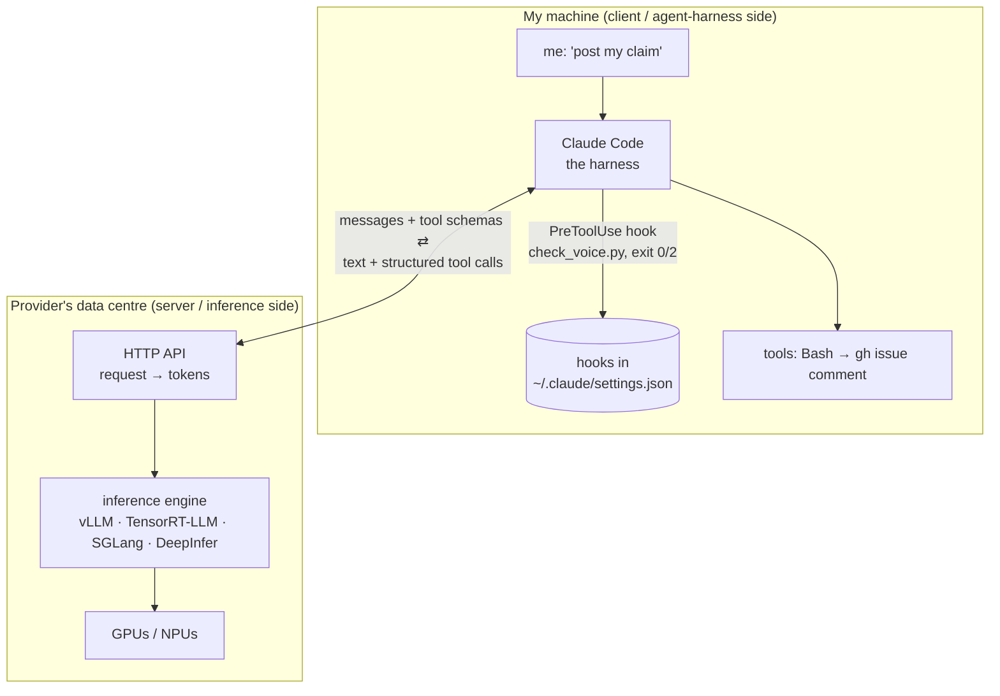

# Unit 6 extra materials: hooks, house rules, and where inference engines fit (2026-10-21)

These are the links the instructor dropped in chat and on slides during the Unit 6 lecture, grouped by theme, with one line each on why they matter for my Unit 6 work. I checked them on 2026-10-21 around 11 PM MDT, with short summaries in my own words and no long quotes.

## 1. Hooks: what they are

| Link | What it is | Why it matters for Unit 6 |
|---|---|---|
| [Claude Code hooks reference](https://code.claude.com/docs/en/hooks) | The official spec: every event, matchers, the JSON input, exit codes, timeouts, `onFailure` | The ground truth behind the voice guard's `settings.json` entry; the "Concurrent hooks" section below is checked against it |
| [Claude Code hooks guide](https://code.claude.com/docs/en/hooks-guide) | A how-to with worked examples and a troubleshooting list | Covers how parallel outputs get combined, and the "hook not firing" checks to use if step 5's wiring test runs unblocked |
| [NHI Mgmt Group: "Agentic hook"](https://nhimg.org/glossary/agentic-hook/) | A security-glossary definition: a deterministic command at a fixed point in an agent's workflow that can allow, deny or enrich an action. It's a policy enforcement point, not a prompt hint | The same idea as the slide "A written rule can get skipped", in security terms. It also names the common mistake of treating a hook like a preference the model will follow |
| [responsibleai/agent-hooks, AGENT-HOOKS-0.1 spec](https://github.com/responsibleai/agent-hooks/blob/main/spec/AGENT-HOOKS-0.1.md) | A framework-neutral draft (0.1.0-beta, dated 2026-10-02): 8 interception points (startup, input, pre/post model call, pre/post tool call, output, shutdown), a verdict format, and rules for combining several interceptors | Shows hooks as a cross-vendor idea. Its defaults are **fail-closed**, unlike Claude Code's (see below) |
| [Medium: "The architecture of agentic AI"](https://medium.com/@eguaikhidee/the-architecture-of-agentic-ai-d6963b9c6168) | The lecture's suggested refresher on the agent loop (model → tool call → result → model) | Where hooks sit in the loop. *I couldn't open it: Medium returned 403 to both my fetchers, so I haven't checked the content.* |
| [MDN `addEventListener`](https://developer.mozilla.org/en-US/docs/Web/API/EventTarget/addEventListener) (on the events slide) | Browser event listeners | The lecture's analogy: a hook is an event listener for Claude Code moments |

## 2. House rules for agents (repo side)

| Link | What it is | Why it matters for Unit 6 |
|---|---|---|
| [cli/cli](https://github.com/cli/cli) + its [CONTRIBUTING](https://github.com/cli/cli?tab=contributing-ov-file) | GitHub CLI, the repo behind the `gh` I use every day; the lecture's "Read before you speak" example | Shows what "read the rules" means in practice: PRs only against `help wanted` issues, never past the acceptance criteria, `make` / `go test ./...` |
| [cli/cli AGENTS.md](https://github.com/cli/cli/blob/trunk/AGENTS.md) | Rules written *for coding agents*. Before preparing any external PR: read CONTRIBUTING, confirm the issue has **both** `help wanted` and explicit acceptance criteria, stay off `core` issues, and never publish security details. It also says agents must **not auto-publish** issues or comments, and not to run acceptance tests that touch real GitHub resources | The model for step 10: Claude Code doesn't read `AGENTS.md` natively, which is why the `CLAUDE.local.md` template starts with `@AGENTS.md`. opengris-scaler ships one too (no AI co-author trailer) |

## 3. Dependency and security hygiene

| Link | What it is | Why it matters for Unit 6 |
|---|---|---|
| Seth Larson (Mastodon), pointing to [certifi advisory GHSA-6q48-6c7w-9gw2](https://github.com/certifi/python-certifi/security/advisories/GHSA-6q48-6c7w-9gw2) | Critical, published 2026-10-20: certifi removes the **emSign** root certificates because intermediates were revoked after a key compromise, which could allow MITM. Affected: ≥ 2019.03.09. The advisory's **patched version is 2026.10.18**; PyPI's latest is **2026.10.19** (checked tonight), which is the version the post asks for | Real-world "dependency hygiene", which is in my fit profile. **My Mac's `python3` (3.9) has certifi 2026.06.17, so it's affected.** To fix (not run by me): `python3 -m pip install --user -U certifi`, and check any uv/venv projects too. It's also a good hook idea: a PostToolUse or ship-gate check that warns when a lockfile pins `certifi<2026.10.18` |

## 4. Padlet: "What can you do if several claims are approved at once?"

My short answer:
- **Choose and release on the same day.** Keep the one that best fits your energy and the deadline, and post a short, honest release on the others ("I won't get to this after all; it's free for someone else"), so nobody waits on you.
- **Don't squat.** Never hold more active claims than you can show progress on. The lecture's own ceiling is 3–5, from different repos. Order the rest by each repo's reply rhythm.
- **If you keep two,** post a concrete first step and a report-back date on each, and keep them in different repos so they don't collide.
- In course terms: only one has to land. Unclaim the others on the Issue Selection site too.

## 5. Concurrent hooks (official docs vs. my ChatGPT dialogue)

**What the dialogue actually contains.** `dlg-chatgpt-6ad94273.json`, three turns from 2026-10-21, not committed. It doesn't discuss Claude Code hooks directly. The three turns are:
1. Who leads Claude at Anthropic. It names Boris Cherny as the Claude Code lead.
2. A claim that Boris Cherny used TLA+ and Lean with Claude to find **race conditions** in the Claude Agent SDK, producing 16 PRs (Sept 2026). The dialogue also says that doesn't mean the codebase was formally verified.
3. YAML vs JSON for validation: JSON is stricter and better for tool calls and payloads, YAML is for human-edited config, and you should validate both against a schema.

How it connects: (2) is the concurrency angle (agent harnesses do have race conditions, and model checking can find them), and (3) answers the lecture's chat question "why JSON?" (hook input and output are JSON). **Not verified:** the TLA+/Lean, 16-PR and model-name details come from ChatGPT's answer with second-hand sources. I didn't confirm them, so treat them as hearsay.

**What the official hooks docs say about concurrency** (reference + guide, read 2026-10-21):

| Question | Official answer |
|---|---|
| Do several matching hooks run one after another? | **No, in parallel.** When an event fires, every matching hook runs at the same time. Prompt/agent-type hooks are capped at 12 running at once, and each waiting hook's timeout starts when it starts |
| Is there an order? | **No guaranteed order** between hooks for one event. Write each hook so it doesn't depend on another running first |
| Two hooks disagree on PreToolUse? | **Most restrictive wins:** deny > defer > ask > allow. An exit-2 STOP counts as deny. Other hooks' side effects, like a log line, still happen |
| Two hooks both rewrite the tool input (`updatedInput`)? | **Last to finish wins, which is non-deterministic.** The guide says don't have more than one hook modify the same tool's input |
| `additionalContext` from several hooks? | All of it is kept and given to Claude together |
| Same hook in user + project + local settings? | **Deduplicated:** the same handler defined in several settings files runs once. A plugin's or skill's copy stays separate. Settings levels *merge*, they don't replace each other |
| Parallel tool calls? | `PreToolUse`/`PostToolUse` fire **per tool**, so they run concurrently when Claude makes parallel tool calls. `PostToolBatch` fires once after the whole batch |
| Timeouts? | Default 600 s for command hooks (the voice guard sets 180). **On PreToolUse a timed-out hook doesn't block**: the call continues unless the hook sets `"onFailure": "block"` |
| Crash or exit 1? | A non-blocking error, so **the action goes ahead** (Crack the Hook says the same). Use exit 2 to enforce, or `onFailure: "block"` |
| Async hooks? | `async: true` runs in the background and can't gate anything. `asyncRewake` wakes Claude on exit 2 |

**Contradictions?** None. The dialogue makes no claims about hook concurrency, so nothing in it conflicts with the docs. Three takeaways for me:
- **Concurrent hooks need no shared state.** The voice guard appends to `guard-log.md`. If I later add a second logging hook, or ship-gate in unit 7 writes the same file, appends from parallel hooks could interleave. Use one log per hook.
- **The voice guard fails open on timeout.** Its internal `claude -p` call has an 80 s timeout inside the 180 s hook limit, so a slow model normally ends as a guard decision, not a hook timeout. Still, Claude Code's default is fail-open, and that's why INSTALL step 5's wiring test matters. Adding `"onFailure": "block"` is optional hardening (it needs a recent Claude Code; I haven't tried it, and the course doesn't ask for it).
- **The draft agent-hooks spec chooses the opposite defaults:** fail closed, a 5 s recommended timeout, and *declared* composition profiles (sequential first-deny, parallel strictest, …). It also says interceptors must tolerate concurrent calls during parallel tool calls and handle their own locking. Claude Code's "parallel, most-restrictive wins" is close to that spec's `parallel/strictest` profile, but on errors it fails open.

## 6. Client side vs server side: where DeepInfer fits

**Is the pasted DeepInfer summary real?** Mostly **yes, as far as I can verify.** There's a public repo, [deepseek-ai/DeepInfer](https://github.com/deepseek-ai/DeepInfer) (Apache-2.0), and press coverage ([The Next Web, 2026-10-20](https://thenextweb.com/news/deepseek-deepinfer-open-source-inference-engine)). They confirm it's DeepSeek's production inference framework, released as **offline inference** for **DeepSeek-V4.1-Flash** on **NVIDIA SM100 and Huawei Ascend 950**, with speculative decoding / verification, SWA bounded replay, a zero-overhead async batch scheduler, deterministic sampling and **structured outputs**. Left out of the release: a KV-cache system, prefill/decode disaggregation and data-parallel load balancing. There's also a companion `deepseek-recipe` for API-matching tokenization. Not verified, so treat as user-pasted: the **"155 trillion tokens a day"** figure and any speed claims. TNW notes the benchmarks are DeepSeek's own and untested. Also, the code says it's **derived from vLLM**, so it isn't built from scratch.

**Is it related to tonight's hooks?** Only loosely. They sit at different layers:

- **Claude Code hooks are client side.** They're deterministic programs on *my* laptop that run around the harness's actions (tool calls, prompts, session start). They never touch model weights or token generation, and they work the same whichever model server is behind them. The agent-hooks spec's `pre_model_call` / `post_model_call` points are still client side: they wrap the *request*, not the engine.
- **Inference engines are server side.** vLLM, TensorRT-LLM, SGLang and DeepInfer turn an already-trained model plus a request into tokens, fast and cheaply: batching, KV cache, speculative decoding, kernels. That's the "execution machinery" in the paste. It's how a provider gets its prices low, not how an agent behaves.
- **The one real touchpoint is structured output and tool calling.** The harness relies on the model returning a well-formed tool call (JSON matching a schema) so it can parse "run `gh issue comment …`", and only then can a PreToolUse hook inspect it. Server-side **constrained decoding** (forcing JSON, regex or grammar) makes those calls reliably parseable. Server-side constraints make the tool call *well-formed*; client-side hooks decide whether it's *allowed*. (`deepseek-recipe`, which matches the API's conversation-to-token formatting, sits at the same boundary.)
- Unit 6 needs none of this. It's background for why "hooks" in agent tooling and "hooks"/callbacks inside serving stacks aren't the same thing.
