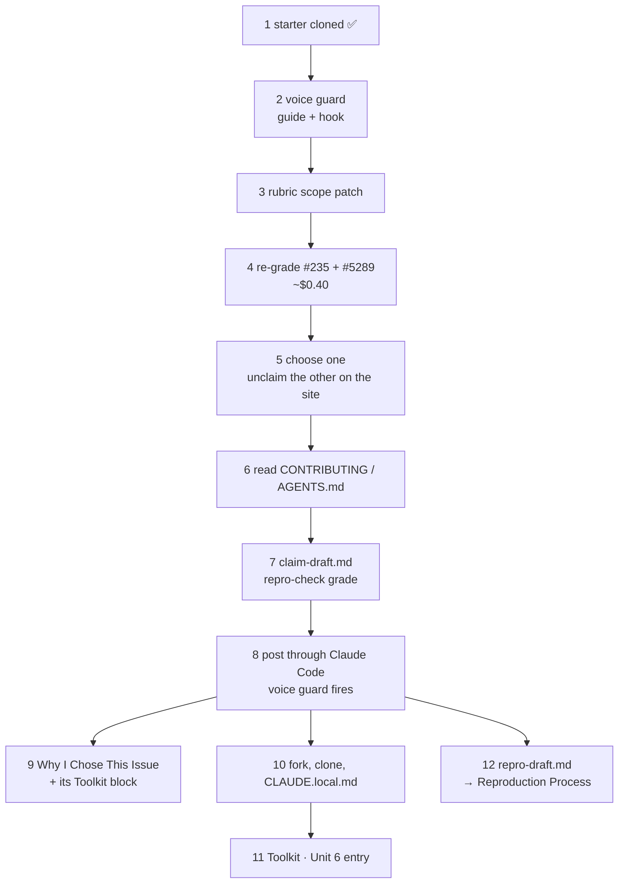

# Unit 6 homework path: how I continue from here (2026-10-21)

Sources: the newer Unit 6 lecture (Oct 21 version, "Claim Day"), the updated course page (Overview / Assignment tabs), and the starter repo [codepath/ai301-unit6-starter](https://github.com/codepath/ai301-unit6-starter) (commit `e14dab1`, cloned to `beat-2-contribution/unit-06/ai301-unit6-starter/` in zimmnotes; not committed anywhere). Everything is summarized in my own words; slide titles are named, not copied.

Status was checked on my Mac on 2026-10-21 around 11 PM MDT. Nothing was installed and no paid `claude` run was made.

## Unit 6 in one picture



Nothing is submitted this week. All of it lands in `contribution-story.md` (Assignment 5, due Sunday at the end of unit 8, **Mon Nov 9, 12:59 AM MST**). The tools themselves are graded in the unit 9 portfolio.

## Step-by-step checklist with my status

| # | Step (Assignment tab) | My status, 2026-10-21 | Output goes to |
|---|---|---|---|
| 0 | (carry-over) Unit 5 Toolkit entry | **todo**: still the placeholder; three-beat draft in [unit-5 homework §7](../unit-5/2026-10-14-unit5-homework-simulated.md) | `contribution-story.md` → Toolkit → Unit 5 |
| 1 | Get the Unit 6 materials | **done**: cloned | (local only) |
| 2 | Install the voice guard (INSTALL.md steps 1–5) + copy the wild scopes | **todo**: `~/.claude/voice-guard/` doesn't exist; `~/.claude/settings.json` has no voice-guard hook; `repro-check/voice-guide.md` has Who / Rules / Never-post but **no Upstream section**; plan-check and pr-precheck still hold their own guide copies | `~/.claude/voice-guard/`, `~/.claude/settings.json`, `~/.claude/skills/{repro,plan}-check/scope.md` |
| 3 | Patch the rubric scope check | **todo** (see the warning below) | `~/.claude/skills/issue-scout/rubric.md` + dated line in `scan-notes.md` |
| 4 | Re-grade my 2 picks (paid, ~$0.20 each) | **todo** | append to `~/.claude/skills/issue-scout/scan-output.md` |
| 5 | Choose one; read every comment; unclaim the rest on the site | **open decision**: see [claim choice note](2026-10-21-claim-choice-235-vs-5289.md) | Issue Selection site |
| 6 | Read the repo's CONTRIBUTING.md (and AI policy) | partly known: opengris has AGENTS.md (no AI co-author trailer) + FINOS CLA; simpler-grants-gov not read yet | notes → CLAUDE.local.md later |
| 7 | Write `claim-draft.md`, grade it with repro-check (paid) | todo | starter folder (local) |
| 8 | Post the claim through Claude Code (voice guard checks it) | todo | the issue's GitHub thread |
| 9 | Why I Chose This Issue + its Toolkit block | todo (`claim pending 2026-10-2x` is allowed until the link exists) | `contribution-story.md` → Why I Chose This Issue (50 pts) |
| 10 | Fork + clone, then `CLAUDE.local.md` | todo | `<my clone>/CLAUDE.local.md`, excluded via `.git/info/exclude` |
| 11 | Unit 6 Toolkit entry | todo | `contribution-story.md` → Toolkit → Unit 6 (part of 40 pts) |
| 12 | Start reproducing: `repro-draft.md`, grade with repro-check (paid), move into the story | todo | `contribution-story.md` → Reproduction Process (3 parts + Toolkit block) |

## Commands, in order (for me to run; I ran none of the installs)

Run from the starter folder: `cd ~/git/zimmnotes/chat/codepath/ai301/beat-2-contribution/unit-06/ai301-unit6-starter`.

**Before step 2, back up:** `cp -R ~/.claude/skills ~/.claude/skills-backup-2026-10-2x && cp ~/.claude/settings.json ~/.claude/settings.json.bak-2026-10-2x`.

Step 2 (INSTALL.md):
1. *One guide again.* Fold any rules added in `plan-check/voice-guide.md` and `pr-precheck/voice-guide.md` back into `~/.claude/skills/repro-check/voice-guide.md`; where they differ, the later week's wording wins.
2. *Extend it upstream.* Append `skill/voice-guide-upstream.md` (everything below its opening comment) and write at least one rule each, with a wrong/right pair, under Claims I post, Questions I ask and Pings I send. Then delete the template comments. Seeds from the lecture, rewritten in my voice: promise a first step and a report-back date, not a finish date; one question, my work shown first, answerable from the maintainer's chair; ping once on the repo's own reply rhythm, carrying something new.
3. *The canonical home:*
   ```
   mkdir -p ~/.claude/voice-guard
   cp skill/check_voice.py skill/hooks-settings.json ~/.claude/voice-guard/
   [ -L ~/.claude/skills/repro-check/voice-guide.md ] || mv ~/.claude/skills/repro-check/voice-guide.md ~/.claude/voice-guard/voice-guide.md
   ln -sf ~/.claude/voice-guard/voice-guide.md ~/.claude/skills/repro-check/voice-guide.md
   ln -sf ~/.claude/voice-guard/voice-guide.md ~/.claude/skills/plan-check/voice-guide.md
   ln -sf ~/.claude/voice-guard/voice-guide.md ~/.claude/skills/pr-precheck/voice-guide.md
   ```
4. *The hook.* `~/.claude/settings.json` exists, so merge the `"hooks" → "PreToolUse"` block by hand, then run INSTALL.md's one-line check. It should print `voice guard hook found` (it currently prints NOT found). Start a fresh `claude` session.
5. *Wiring test only* (this one is supposed to be STOPPED): `claude "run this command: gh issue comment --help"`.
6. *Wild scopes:*
   ```
   cp skill/repro-check-scope-wild.md ~/.claude/skills/repro-check/scope.md
   cp skill/plan-check-scope-wild.md ~/.claude/skills/plan-check/scope.md
   ```

Things to know before installing:
- The hook is **user-global**, with matcher `Bash`, so it runs before every Bash command in every Claude Code session. It costs nothing unless the command is `gh issue|pr comment|create`, and then it calls `claude -p --model sonnet` on the body, which spends a few cents of course credit. Timeout is 180 s.
- `check_voice.py` compiles and runs on my Mac's Python 3.9.6, and a non-posting command exits 0. I checked that on a /tmp copy, with no model call.
- Bodies it can't read are stopped on purpose: `--web`, `--body-file -`, and no body at all. Post with `--body-file claim-draft.md`. For a browser post, run `python3 ~/.claude/voice-guard/check_voice.py --draft claim-draft.md` first.

Step 3 (rubric patch). Open `skill/rubric-scope-patch.md`. In `rubric.md`, replace my **`scope-fits-newcomer`** row with the **`scope-feasible`** row, add the "difficulty note" section under the checks table, and add a dated line to `scan-notes.md` naming `scope-fits-newcomer` as the replaced check.

> **Warning: the patch erases my own Unit 5 fix.** My fail condition (6), "blocked on an open prerequisite" (added 2026-10-15 after #235), lives *inside* `scope-fits-newcomer`. `scope-feasible` fails only when an issue isn't one piece of work, and treats open edges as difficulty. So after a plain swap, **#235 would most likely flip from reject to accept with an "ambitious" difficulty note** (its open edge is "can this go ahead before #233 / #951?"). I have two honest options:
> - (a) Take the staff patch as written, so being blocked becomes the ambitious note's named open edge and the first question in my claim. Log in `scan-notes.md` that condition (6) was retired by the patch.
> - (b) Keep condition (6) as its own small required row (e.g. `not-blocked`). That's a deliberate deviation from the staff patch, so say so in the Toolkit block, and know that the Unit 1 gold-label agreement could shift. Checking it means a paid Unit 1 harness run.
> Either way, this is good Toolkit material: my patch from last week ran into the staff patch this week.

Step 4 (paid, I run it): `claude "issue-scout: grade https://github.com/finos/opengris-scaler/issues/235 https://github.com/HHS/simpler-grants-gov/issues/5289"`, then paste the read-out under last week's in `scan-output.md`.

Steps 7, 8 and 12 (paid, I run them), from the starter folder:
```
claude "repro-check: grade my draft claim comment in claim-draft.md for issue <URL>"
claude "run this command: gh issue comment <URL> --body-file claim-draft.md"
claude "repro-check: grade my claim comment in claim-draft.md and my repro report in repro-draft.md for issue <URL>"
```
`claim-draft.md` and `repro-draft.md` stay in the starter folder. Don't commit them to the preview repo, and don't post the repro report on the issue.

Step 10: fork on GitHub, clone **my fork**, then:
```
cp skill/claude-local-template.md <clone>/CLAUDE.local.md
cd <clone> && echo CLAUDE.local.md >> .git/info/exclude && git status   # file must not appear
```
Step 0 of the template: opengris-scaler ships a root `AGENTS.md`, so keep the `@AGENTS.md` import line if I pick #235. Otherwise check what simpler-grants-gov ships. Do **one** scoped orientation run over only the subsystem the issue touches, then distill it to under about 60 lines.

## How the #235 vs #5289 decision fits

- **Step 3 changes the evidence.** After the patch, the scout probably no longer *rejects* #235; it flags it **ambitious**. The lecture's choice slide treats "ambitious" as fine if I have the energy for it. The open edge becomes the first question in the claim.
- **Step 4 gives me fresh verdicts with difficulty notes.** My guess: #5289 straightforward, #235 ambitious. Quote both in Why I Chose This Issue.
- **Step 5 is the three lenses**: fit, energy, and my own read of the thread. Then **Unclaim** the unused pick on the site (the course page now says "Unclaim", per pick).
- **Lecture timing rule:** grade and claim in the same sitting, because a shortlist goes stale. So do steps 4→8 in one session, not spread over days.
- **The flip rule:** a stranger's claim blocks me, even in a comment and even with nobody assigned. Read every comment right before posting (Crack the Hook level 2 is exactly this).
- **Several claims:** the lecture allows working a second thread from a *different repo* if the first goes quiet. #235 and #5289 are in different repos, so holding #5289 as a fallback is legitimate, as long as I release whichever I drop.
- Live state of both issues and the side-by-side comparison: [claim choice note](2026-10-21-claim-choice-235-vs-5289.md). Both were created over a year ago (#235 on 2025-09-18, #5289 on 2025-06-10). That matters for the "new" filter idea: see the [fit filter proposal](2026-10-21-fit-filter-update-proposal.md).

## Lecture slide → artifact → story chapter

| Lecture slide (title) | What it asks for, in short | My artifact | Story chapter it feeds |
|---|---|---|---|
| "Your scans, two weeks in" / "The top five, graded" | Queries that trace to the profile; verdicts that quote evidence; your first issue comes from the site, not a scan | Unit 5 scan (397 → 255 → 5) + step 9 grades | Why I Chose This Issue ("how I searched") |
| "Why you claim the same hour" | A shortlist goes stale; grade the pick and claim right after | step 4 re-grade → step 8 claim, same session | Why I Chose This Issue (claim link) |
| "The claim you already know" | Intent, a first step, a checkable scope | `claim-draft.md` | Why I Chose This Issue; Pull Request (claim link, part of 60) |
| "The rule that flips" | A stranger's claim blocks you; release your own honestly | the site Unclaim + read every comment | Learnings and Reflections |
| "Questions maintainers answer" / "Pings run on the repo's clock" | One question, your work shown first; ping once with something new; silence isn't a verdict | Upstream rules in `voice-guide.md` | Toolkit · Unit 6 |
| "Read before you speak" (cli/cli house rules) | Read CONTRIBUTING.md + AGENTS.md: PR needs, scope, test commands, AI rules | step 6 notes | CLAUDE.local.md; Learnings |
| "The skill repo gets a memory" | One scoped orientation run, paid once, into `CLAUDE.local.md`, kept out of git with `.git/info/exclude` | `<clone>/CLAUDE.local.md` | Toolkit · Unit 6 ("repo memory") |
| "A written rule can get skipped" → hook basics (what / events / where / one entry / exit codes) | A rule in text gets buried; a hook can't be skipped. PreToolUse + matcher `Bash`, settings.json, JSON in, exit 0 or 2 out | `~/.claude/settings.json` entry + `check_voice.py` | Toolkit · Unit 6 ("voice guard") |
| "Your rules check every post" / "Your voice guide grows up" | One canonical guide; new Upstream section with wrong/right pairs you write | `~/.claude/voice-guard/voice-guide.md`, `guard-log.md` | Toolkit · Unit 6 ("what broke / what changed") |
| "The choice stays yours" | Patched rubric: scope-feasible + difficulty note; three lenses: fit, energy, your read | `rubric.md` patch + `scan-output.md` re-grade | Why I Chose This Issue + its Toolkit block (issue-scout) |
| "Your story starts this week" | Why I Chose: source, verdict quoted, claim link, your why, including disagreement; Toolkit Unit 6, 2–4 sentences | `contribution-story.md` | Why I Chose This Issue (50) + Toolkit (40) |
| Activity: Crack the Hook | Guess, pick the rule, find the slip, fix | [simulated game](2026-10-21-crack-the-hook-simulated.md) | (practice; one line in Learnings at most) |
| (whole lecture) | — | — | **Resources Used**: "AI301 Unit 6 lecture, Claim Day", by title only |

## What changed vs last week's course page (Oct 14 copy → Oct 21 copy)

- **Where the pick comes from.** Last week: a fresh scan at the start of class, choose from *its* top five, and claim in the same session. Now: choose from the 2–3 Issue Selection site picks I already graded, and claim as **homework**, not in class.
- **The activity.** Last week: the claim and upstream voice rules drafted live during the activity, with the protocol on the Activity tab. Now: the activity is the **Crack the Hook** game, and claiming moves to Assignment steps 5–8.
- **The Assignment tab is now 12 concrete steps** (the Oct 14 copy had the same overview text pasted under all three tabs). New specifics: the copy commands for the wild scopes, the named staff `scope-feasible` patch with the difficulty note, the paid re-grade, posting through Claude Code, `CLAUDE.local.md` from a template, and starting the Reproduction Process section. It also gives a points map: choosing 50, reproduction part of 50, claim link part of 60, Toolkit 40, and "nobody grades whether you picked the right issue".
- **Wording.** "Posting doorway" is gone (the starter's commit history also drops it). The hook is now explained step by step: events, where settings live, JSON in, exit code out.
- **Session timing.** The course page says lecture 45 / activity 50 / wrap-up 10. The slides' agenda says lecture 55 / activity 45 / wrap-up 5 (the setup slide says 50 for breakouts). Minor; nothing depends on it.
- **A paste slip in my local copy.** In my updated `Overview-Activity-Assignment.txt`, the **Activity** tab holds the Assignment text again, not the game instructions. The game steps are in the lecture and the game README, so nothing is missing for me, but re-copy that tab if I want it archived.
- **The lecture versions.** Compared with the Oct 14 slide text, the Oct 21 slides drop the in-class "draft now" moment and the old activity, and add the five "Hook basics" slides plus three Crack the Hook slides.

## Next 5 actions (in order)

1. Paste my rewrite of the Unit 5 Toolkit entry into `contribution-story.md` and commit (it's carried over from last week).
2. Back up `~/.claude`, then do step 2: the guide fold + Upstream rules, the install, and the wiring test.
3. Step 3: decide between (a) and (b) above for condition (6), patch, and log it.
4. Check whether the #5289 browserslist warning is still real, then do steps 4 → 5 → 6 → 7 → 8 in **one sitting**.
5. Steps 9–12: Why I Chose, then CLAUDE.local.md, the Unit 6 Toolkit entry, and repro-draft.
