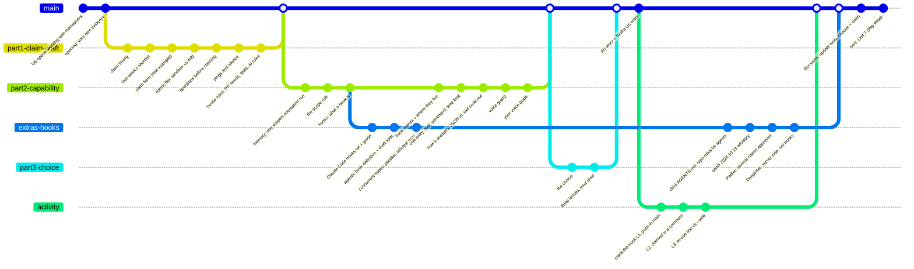

# Unit 6: Claim Day (Oct 21) — notes for this week

These are my working notes, not the graded file. For every week, see the [notes hub](../../NOTES-HUB.md); the graded file is `beat-2-contribution/contribution-story.md` in ai301-coursework.

| Note | Purpose |
|---|---|
| [2026-10-21-unit6-homework-path.md](2026-10-21-unit6-homework-path.md) | **Start here.** Assignment steps with my status, commands, where each output goes |
| [2026-10-21-claim-choice-235-vs-5289.md](2026-10-21-claim-choice-235-vs-5289.md) | Keep opengris-scaler#235 or swap to simpler-grants-gov#5289 |
| [2026-10-21-fit-filter-update-proposal.md](2026-10-21-fit-filter-update-proposal.md) | Adding "learning value / manageable / new" to the scout |
| [2026-10-21-crack-the-hook-simulated.md](2026-10-21-crack-the-hook-simulated.md) | Simulated run of the breakout game I skipped (spoilers) |
| [2026-10-21-unit6-extra-materials.md](2026-10-21-unit6-extra-materials.md) | Instructor's extra links, concurrent hooks, client vs server side (DeepInfer) |

## Today's topics at a glance

The lecture runs along `main` in three parts. The activity and the instructor's extra materials branch off where they connect. Slide titles are paraphrased.

How to read it: hooks are the main thread of today's lecture. The extras branch starts at "what a hook is", because almost every link the instructor shared expands on hooks: the official reference, the definition and spec, and concurrent hooks. The last few extras come from repo rules for agents, dependency hygiene and the claims question, so they come back in at the end. DeepInfer sits on that branch only to mark the boundary: hooks run on my machine, and DeepInfer runs on the provider's servers.
