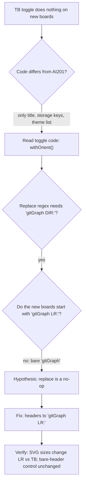

# AI301 status boards (Unit 3 + Unit 5 / Beat 2)

Personal coach board for the **Unit 3 Plan & Build homework arc**: Mermaid overview plus expand/collapse branch cards.

**Trilogy-preview only.** This lives in [`speculaas/ai301-coursework-trilogy-preview`](https://github.com/speculaas/ai301-coursework-trilogy-preview). It is **not** the portal submit. Graders want the whole [`speculaas/ai301-coursework`](https://github.com/speculaas/ai301-coursework) repo-root URL, not this board and not a folder URL.

**Not today's worksheet.** The live activity (Wed Sep 30, 2026, 4:00 PM MDT) still uses the group Doc and [`2026-09-30-unit3-activity-today.md`](../../beat-1-sandbox/unit-3/2026-09-30-unit3-activity-today.md). This board is the homework thread beside that, not a replacement.

**Not repository commit history** — conceptual workstreams only.

**Interaction:** click a gitGraph commit to open the matching milestone; click a card to highlight the graph. Every `commit id` in `mermaid` matches a `branches[].nodes[].title` (branch id/label also link). Header search scans nodes; Back restores the cards. Direct link: `?board=ai301-unit3`.

## Run locally

`fetch()` needs HTTP. Opening `index.html` as `file://` will not load `data/boards.json`.

```bash
cd docs/status   # from ai301-coursework-trilogy-preview root
python3 -m http.server 8766
```

Open [http://127.0.0.1:8766/](http://127.0.0.1:8766/)

## Edit content

`data/boards.json` defaults to board id `ai301-unit3`, which loads `data/workstream.json`:

- top: `title`, `caption`, `mermaid` (gitGraph string), `branches[]`
- branch: `id`, `label`, `status` (`done` | `open` | `blocked`), `summary`, `nodes[]`
- node: `id`, `title`, `status`, `detail`

To add another board: drop a same-schema JSON file under `data/`, register a unique `id`, filename, and `label` in `data/boards.json`, then open `?board=<id>`. No build step.

## Notes this board is grounded in

- Session prep: [`../../beat-1-sandbox/unit-3/2026-09-29-unit3-session-prep.md`](../../beat-1-sandbox/unit-3/2026-09-29-unit3-session-prep.md)
- Activity today (checklist + DRAFTs): [`../../beat-1-sandbox/unit-3/2026-09-30-unit3-activity-today.md`](../../beat-1-sandbox/unit-3/2026-09-30-unit3-activity-today.md)

Continuity is Path Review issue 73 (`OPENROUTER_API_KEY` docs vs `.env.example`). Only that Unit 2 claim/repro and the preview notes are marked done. Skill, eval, plan/build, and submit stay open. Project 3 due Mon Oct 5, 2026, 12:59 AM MDT.

## Reframework credit

Board assets (`app.js`, `styles.css`, `index.html`, `.nojekyll`) are a copy of the AI201 lab6 / FedPrint `docs/status` pattern. Source (not modified):

`zimmnotes/chat/codepath/ai201/m2/w6/ai201-lab6-grocerylist-starter/docs/status/`

That copy originally came from the FedPrint status board. Optional prompt docs, if you extend the pattern, stay with AI201 tooling: `zimmnotes/chat/codepath/ai201/llm/docs/workstream-board/`.

```bash
SRC="/Users/watney/git/zimmnotes/chat/codepath/ai201/m2/w6/ai201-lab6-grocerylist-starter/docs/status"
DEST="/Users/watney/git/zimmnotes/chat/codepath/ai301/ai301-coursework-trilogy-preview/docs/status"

mkdir -p "$DEST/data"
cp -v "$SRC/app.js" "$SRC/styles.css" "$SRC/index.html" "$SRC/.nojekyll" "$DEST/"
```

## Unit 5 / Beat 2 boards (added 2026-10-14)

Boards: `unit3` stays (`?board=ai301-unit3`); default is now `unit5-homework`. Code files are an exact copy of AI201 (theme button still cycles to `dark`; default is light). Mermaid strings must start `gitGraph LR:` (with colon) or the LR/TB toggle does nothing.

Static workstream-board viewer reused from the AI201 `docs/status` board (ai201-lab6-grocerylist-starter). Conceptual workstreams only, **not** repo commit history. Light theme only.

**Expected URL** (after push + Pages from `main` `/docs`): https://speculaas.github.io/ai301-coursework-trilogy-preview/status/  
Direct board: `?board=unit5-homework`, `?board=beat2-a5`, `?board=roadmap-gitgraph`.

### Run locally

```bash
cd docs/status
python3 -m http.server 8766   ## file:// cannot fetch the JSON
```

### Update rules

- Each board = `data/<id>.json` with `title`, `caption`, `mermaid` (gitGraph), `branches[]` (cards; `status`: `done` | `open` | `blocked`).
- Card `nodes[].title` must equal the gitGraph commit `id` exactly (click-to-focus matches on it). Commit ids must be unique.
- Step finished: drop the `NEXT`/`T` prefix, add date or hash, in **both** the mermaid line and the node title; set `status: "done"`.
- New work = new `commit` line + node; side thread = new `branch` + new card.
- Blocked: `BLOCKED: ...` + `type: REVERSE` in mermaid, `status: "blocked"` on the node.
- New board: add the JSON and register `id`/`file`/`label` in `data/boards.json`.
- Keep the Markdown copy in `beat-2-contribution/unit-5/2026-10-14-ai301-status-boards.md` in sync.

## How the LR/TB bug was found (2026-10-15)

Honest account: it was not trial and error, and I didn't see it right away either. The diff ruled out the code, and then the toggle's regex showed the cause on the first read. I did the "before" repro *after* the fix, as a control.

1. **Diff the code against AI201** (`diff` of `index.html`, `app.js`, `styles.css`, `.nojekyll`). The only differences were the `<title>`, the three `localStorage` key names, and `dark` removed from `MERMAID_THEMES`. None of these touch orientation, so they're irrelevant. The same check showed the local AI201 folder is 4 commits behind origin, but those commits only add data files, so the code matches what's deployed.
2. **Read the toggle code.** In the same command I grepped `app.js` for `detectOrient`/`gitGraph`, which led to:
   ```js
   function withOrient(code, orient) {
     const dir = orient === "TB" ? "TB" : "LR";
     const src = String(code || "");
     if (/^\s*gitGraph\b/i.test(src)) {
       return src.replace(/^\s*gitGraph\s*(LR|TB|BT|RL)?\s*:/i, `gitGraph ${dir}:`);
     }
     return `gitGraph ${dir}:\n${src}`;
   }
   ```
   The replace regex needs a **colon** after `gitGraph [dir]`. The guard `gitGraph\b` matches a bare `gitGraph`, but then the replace finds nothing, and the source comes back unchanged.
3. **Compare the first lines of the board JSON.** `workstream.json` (Unit 3, which worked) starts with `gitGraph LR:\n`. My three new boards started with `gitGraph\n`, with no direction and no colon.
4. **Hypothesis:** with a bare header, the toggle is a no-op, so TB renders identically to LR.
5. **Fix:** `gitGraph LR:` headers in `unit5-homework.json`, `beat2-a5.json` and `roadmap-gitgraph.json`. I also copied the code files back exactly from AI201.
6. **Verify** with headless Chromium (puppeteer) on a served copy, clicking `#orient-lr` and then `#orient-tb` and measuring the SVG bounding box. As a control, I put the bare `gitGraph` header back on unit5-homework, and it stayed 840×313 for both LR and TB, which reproduced the bug.

| Board | LR (w×h) | TB (w×h) |
|---|---|---|
| unit5-homework | 840×313 | 374×807 |
| beat2-a5 | 1130×486 | 717×1189 |
| roadmap-gitgraph | 998×385 | 541×1001 |
| ai301-unit3 | 1271×591 | 824×1215 |
| unit5-homework, bare header (control) | 840×313 | 840×313 |



**Lesson (contract):** every board's `mermaid` string must start with `gitGraph LR:` (or `TB:`), with a direction and a colon. A bare `gitGraph` is valid Mermaid, but the viewer's LR/TB toggle silently ignores it.
